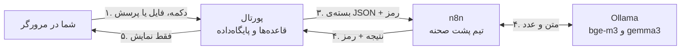

# پشت صحنه‌ی عامل‌های هوش مصنوعی، به زبان ساده

این سند همان چیزی را که در `docs/system-guide-fa.md` آمده، این بار به شکل «داستان» تعریف می‌کند: شما در پورتال دکمه‌ای را می‌زنید و ما قدم‌به‌قدم دنبال می‌کنیم پشت صحنه چه اتفاقی می‌افتد. مثال‌ها با کاربر نمونه‌ی **سارا نوری** (`sara.nouri`) است.

## پیش از شروع: بازیگران پشت صحنه

یک تشبیه ساده کمک می‌کند:

| بازیگر | تشبیه | کارش |
|---|---|---|
| **پورتال (Django)** | کارمند باجه‌ی آموزش که آیین‌نامه را از حفظ است | با شما حرف می‌زند، قواعد را اجرا می‌کند، همه‌چیز را در پرونده (پایگاه‌داده) ثبت می‌کند |
| **n8n** | تیم پشت‌صحنه در اتاق کناری | کارهای «هوش مصنوعی» را انجام می‌دهد و نتیجه را به باجه برمی‌گرداند |
| **`bge-m3`** (روی Ollama) | «سنجنده‌ی معنا» | هر متن را به یک فهرست حدود هزارتایی از عدد (بردار) تبدیل می‌کند؛ متن‌های هم‌معنا عددهای نزدیک به هم می‌گیرند |
| **`gemma3:4b`** (روی Ollama) | «نویسنده و خواننده» | متن می‌خواند و متن می‌نویسد (پیدا کردن بخش‌ها، نوشتن جواب، نوشتن ایمیل) |
| **Mailpit** | صندوق نامه | ایمیل‌ها به آن‌جا می‌رسد (`http://localhost:8025`) |

**الگوی مشترک همه‌ی عامل‌ها، در ۵ قدم:**

1. شما کاری می‌کنید (دکمه می‌زنید، فایل می‌گذارید، پرسش می‌نویسید).
2. پورتال با **قاعده‌های ثابت** تصمیم می‌گیرد چه چیزی به n8n بدهد (مثلاً فقط استادانی که ظرفیت دارند).
3. پورتال یک «بسته» (JSON) با یک رمز مشترک (`X-Agent-Token`) برای n8n می‌فرستد.
4. n8n با کمک مدل‌ها کار را انجام می‌دهد و نتیجه را با همان رمز به پورتال برمی‌گرداند.
5. پورتال نتیجه را **دوباره بررسی** می‌کند، ذخیره می‌کند و به شما **فقط نشان می‌دهد**. تصمیم نهایی همیشه با شماست.

---

## عامل ۱: «پیشنهاد استاد راهنما»

**صحنه:** سارا پرونده‌اش را ثبت کرده و در صفحه‌ی «انتخاب استاد راهنما» است. در کادر «موضوع و علایق پژوهشی من» می‌نویسد:
> «می‌خواهم روی عامل‌های مبتنی بر مدل زبانی و خودکارسازی فرایندهای اداری کار کنم.»

و دکمه‌ی **«پیشنهاد استاد راهنما»** را می‌زند.

**پشت صحنه:**

1. **مرورگر فرم را به پورتال می‌فرستد.** پورتال اول چند چیز ساده را می‌سنجد: این پرونده مال خود ساراست؟ هنوز در مرحله‌ی «انتخاب استاد راهنما» است؟ متن بین ۲۰ تا ۱۵۰۰ نویسه است؟ اگر نه، همان‌جا پیام خطا می‌دهد.
2. **پورتال «موضوع» را می‌سازد:** عنوان فارسی + عنوان انگلیسی پرونده + همان متنی که سارا نوشت، پشت سر هم.
3. **پورتال با قاعده‌ی ثابت نامزدها را انتخاب می‌کند:** همه‌ی اعضای هیئت‌علمی فعال که **کمتر از ۲ دانشجو** دارند. مثلاً دکتر فلاح که ۲ دانشجو دارد اصلاً در فهرست نیست. اینجا هیچ هوش مصنوعی‌ای دخالت ندارد. برای هر نامزد شناسه، نام، گروه و متن «زمینه‌های تخصصی» او برداشته می‌شود.
4. **پورتال یک ردیف «در حال آماده‌سازی» در پایگاه‌داده می‌سازد** و بسته را به n8n می‌فرستد. n8n فوراً می‌گوید «گرفتم» و کار را شروع می‌کند. پورتال منتظر نمی‌ماند و به سارا صفحه‌ای با «در حال یافتن استادان مرتبط…» نشان می‌دهد که هر ۵ ثانیه خودش تازه می‌شود.
5. **در n8n، رمز بررسی می‌شود.** استادانی که تخصصشان را ننوشته‌اند کنار گذاشته می‌شوند (چیزی برای مقایسه ندارند).
6. **«سنجنده‌ی معنا» (`bge-m3`) همه‌ی متن‌ها را به عدد تبدیل می‌کند:** متن سارا و متن تخصص هر استاد، هرکدام می‌شود یک فهرست حدود هزارتایی از عدد. می‌شود این را مثل «مختصات روی نقشه‌ی معنا» تصور کرد: متن‌هایی که درباره‌ی چیزهای شبیه حرف می‌زنند، روی این نقشه نزدیک هم می‌افتند، حتی اگر کلمه‌هایشان فرق کند.
7. **n8n نزدیکی را با یک فرمول ریاضی حساب می‌کند** (شباهت کسینوسی): برای هر استاد یک عدد بین ۰ و ۱. مثلاً (عددها فقط برای نمونه‌اند): استادی با تخصص «داده‌کاوی، سامانه‌های توصیه‌گر» ۰٫۶۲، استادی با «اینترنت اشیا» ۰٫۴۱. سپس از بزرگ به کوچک مرتب می‌کند. **این رتبه‌بندی کار مدل زبانی نیست، یک حساب ریاضی است**؛ برای همین قابل‌اعتماد و تکرارپذیر است.
8. **۵ نفر اول به «نویسنده» (`gemma3:4b`) داده می‌شوند** با این دستور: «برای هر استاد در یک جمله بگو تخصصش چه ربطی به علایق دانشجو دارد؛ فقط از متن تخصص همان استاد استفاده کن، چیزی از خودت نساز، و نگو کدام را انتخاب کند.» مدل یک JSON با یک جمله برای هر استاد برمی‌گرداند.
9. **n8n عددها و جمله‌ها را کنار هم می‌گذارد** (اگر مدل جمله‌ای نداد، فهرست بدون جمله می‌رود) و نتیجه را با رمز به پورتال پس می‌فرستد.
10. **پورتال دوباره بررسی می‌کند:** فقط استادانی را نگه می‌دارد که **همین حالا** هنوز ظرفیت دارند (شاید در این چند ثانیه ظرفیت کسی پر شده باشد). رتبه را خودش از روی عددها می‌سازد و ردیف را «آماده» می‌کند.
11. **صفحه‌ی سارا که تازه می‌شود،** کادر «پیشنهاد سامانه» را می‌بیند: نام هر استاد، درصد تطبیق با علایقش، تعداد دانشجویان فعلی آن استاد، و جمله‌ی توضیح. فهرست انتخاب پایین صفحه هم به همان ترتیب مرتب شده و کنار هر نام «(پیشنهاد سامانه: رتبه‌ی ۱)» آمده، اما **هیچ گزینه‌ای از قبل انتخاب نشده است.**
12. **سارا خودش هر استادی را که بخواهد انتخاب می‌کند** (حتی رتبه‌ی پنجم). از این‌جا به بعد یک اقدام عادی انسانی است و درخواست برای استاد می‌رود.

**اگر چیزی خراب باشد:** اگر n8n یا Ollama خاموش باشد، کادر می‌گوید «سرویس پیشنهاد استاد در دسترس نیست» و سارا مثل قبل از فهرست کامل انتخاب می‌کند. اگر تا ۱۰ دقیقه جوابی نیاید، «پاسخی نرسید» نمایش داده می‌شود.

*در کد:* `agents/views.py` ← `advisor_suggestions_request`؛ `agents/services.py` ← `request_advisor_suggestions` و `save_referee_suggestions`؛ گردش‌کار `n8n/workflows/03-referee-suggestion.json`.

---

## عامل ۲: «پیشنهاد داور» (برای مدیر گروه)

این همان عامل ۱ است با دو فرق. **صحنه:** کارشناس آموزش (`maryam.salehi`) روی «ثبت دریافت پیشنهاد» می‌زند.

1. پرونده به وضعیت «در انتظار تخصیص داور» می‌رود. همین تغییر وضعیت به‌طور **خودکار** عامل را بیدار می‌کند؛ کسی دکمه‌ای نمی‌زند.
2. **فرق اول، موضوع:** این بار موضوع را خود پورتال از سند می‌سازد: عنوان‌ها + حدود ۲۰۰۰ نویسه از ابتدای بخش «مقدمه»ی آخرین نسخه‌ی پیشنهاد (صفحه‌ی اول فرم برای همه یکسان است، پس از آن رد می‌شود).
3. **فرق دوم، نامزدها:** اعضای هیئت‌علمی **همان گروه آموزشی**، به‌جز استاد راهنما و خود دانشجو.
4. بقیه‌ی مسیر دقیقاً همان قدم‌های ۴ تا ۱۰ عامل ۱ است.
5. وقتی مدیر گروه (`ali.ahmadi`) فرم «تخصیص داور» را باز می‌کند، کادر پیشنهاد را با رتبه، درصد شباهت، **تعداد داوری‌های در جریان** هر استاد و جمله‌ی توضیح می‌بیند. چک‌باکس‌ها به ترتیب رتبه‌اند و هیچ‌کدام تیک نخورده. اگر بخواهد، دکمه‌ی «تازه‌سازی» پیشنهاد را دوباره می‌سازد.

*در کد:* `agents/services.py` ← `_suggest_on_assignment`، `topic_text`، `request_referee_suggestions`.

---

## عامل ۳: «بررسی خودکار قالب» هنگام بارگذاری

**صحنه:** سارا فایل پیشنهادش (`proposal-sara-nouri-incomplete.docx` از `docs/samples/`) را بارگذاری می‌کند. در این فایل بخش «روش ارزیابی» جا مانده است.

**پشت صحنه:**

1. **پورتال فایل را ذخیره می‌کند** (نسخه‌ی ۱) و در دفتر رویدادهای پرونده می‌نویسد «پیشنهاد بارگذاری شد».
2. **یک «شنونده» در پورتال این رویداد را می‌بیند.** فقط وقتی ذخیره‌سازی کاملاً قطعی شد، می‌گوید «سند تازه آمد، بررسی‌اش کنید».
3. **پورتال متن فایل را بیرون می‌کشد** (از DOCX یا PDF) و یکدستش می‌کند: «ي» و «ك» عربی به «ی» و «ک» فارسی، حذف نشانه‌های نامرئی، و تعمیر عددهای وارونه در PDF. اگر متن کمتر از ۳۰۰ نویسه باشد (مثلاً PDF اسکن‌شده که فقط عکس است)، همان‌جا می‌گوید «متن قابل‌خواندنی پیدا نشد» و کار تمام است.
4. **پورتال چک‌لیست را آماده می‌کند:** برای پیشنهاد ۱۳ مورد (۸ بخش: عنوان، مقدمه، مرور پیشینه، رویکرد، روش ارزیابی، زمان‌بندی، امکانات، مراجع؛ و ۵ فیلد صفحه‌ی اول: نام، شماره دانشجویی، ایمیل، نیم‌سال، نام استاد راهنما). هر مورد یک راهنمای کوتاه دارد، مثلاً «بخشی با عنوان «روش ارزیابی» که می‌گوید نتیجه چطور سنجیده می‌شود».
5. **پورتال یک ردیف «در حال بررسی» می‌سازد** و متن + چک‌لیست را برای n8n می‌فرستد. سارا زیر فایلش «در حال بررسی…» می‌بیند و صفحه هر ۵ ثانیه تازه می‌شود.
6. **n8n متن را تکه‌تکه می‌کند:** هر تکه ۴۰۰۰ نویسه، با ۵۰۰ نویسه هم‌پوشانی با تکه‌ی بعد (تا عنوانی که دقیقاً روی مرز افتاده گم نشود). مثلاً یک متن ۱۸ هزار نویسه‌ای می‌شود ۵ تکه. *چرا؟* مدل کوچک محلی نمی‌تواند کل سند را یک‌جا بخواند.
7. **برای هر تکه از «نویسنده» (`gemma3:4b`) می‌پرسد:** «کدام موارد این فهرست در همین تکه هست؟ برای هرکدام، یک نقل‌قول عینی حداکثر ۱۲ کلمه‌ای از متن بیاور. اگر مطمئن نیستی نیاور. درباره‌ی کیفیت علمی نظر نده. فقط JSON بنویس.» جواب مثلاً این است: «مقدمه پیدا شد، شاهد: «۱. مقدمه»».
8. **n8n حرف مدل را راستی‌آزمایی می‌کند** (مهم‌ترین قدم): آیا آن نقل‌قول **واقعاً** در همان تکه هست؟ اگر بود، مورد «پیدا شد». اگر نبود، یعنی مدل احتمالاً از خودش ساخته و مورد «تأییدنشده» علامت می‌خورد. یک قاعده‌ی دیگر: اگر مدل یک جمله را شاهد دو بخش مختلف آورده باشد (مثلاً عنوان «مراحل انجام و زمان‌بندی» را هم برای «زمان‌بندی» و هم برای «روش ارزیابی»)، فقط بخشی پذیرفته می‌شود که اسمش بیشتر به آن جمله می‌خورد. همین قاعده باعث می‌شود جا ماندن «روش ارزیابی» پنهان نماند.
9. **n8n نتیجه‌ی همه‌ی تکه‌ها را جمع می‌کند** و برای پورتال می‌فرستد.
10. **پورتال برای هر مورد چک‌لیست یک سطر می‌سازد:** ✓ با نقل‌قول از متن، یا ✗ «این بخش در متن سند پیدا نشد»، یا ✗ «مدل این را موجود گفت ولی شاهدش تأیید نشد؛ خودتان بررسی کنید». کل نتیجه «مطابق قالب» یا «۱ مورد نیازمند توجه» می‌شود.
11. **سارا کادر «بررسی خودکار قالب» را می‌بیند**، با ✗ قرمز کنار «روش ارزیابی». حالا دو راه دارد: فایل را درست کند و نسخه‌ی ۲ را بارگذاری کند (همه‌ی این قدم‌ها دوباره تکرار می‌شود)، یا **همین نسخه را بفرستد**. بررسی هیچ‌وقت جلوی ارسال را نمی‌گیرد.
12. **پس از ارسال، کادر برای همیشه پنهان می‌شود.** استاد راهنما و داور هرگز آن را نمی‌بینند، تا نظر مدل روی داوری انسانی اثر نگذارد.

برای **پایان‌نامه** هم دقیقاً همین اتفاق می‌افتد؛ فقط چک‌لیست ۸ فصل پایان‌نامه است (عنوان، چکیده، مقدمه، پیشینه، روش، ارزیابی، جمع‌بندی، مراجع).

*در کد:* `agents/services.py` ← `_validate_on_upload`، `request_validation`، `save_validation_result`، `validation_visible_to`؛ `agents/checklist.py`؛ `agents/extract.py`؛ گردش‌کار `n8n/workflows/01-document-validation.json`.

---

## عامل ۴: «دستیار آیین‌نامه»

**یک کار مقدماتی که فقط یک‌بار انجام می‌شود** (با دستور `python manage.py index_policy`): پورتال متن آیین‌نامه (فعلاً «توضیحات ۱ تا ۵» فرم پیشنهاد، در `agents/knowledge/FORM-PROPOSAL.md`) را از روی عنوان‌ها به بندهای کوچک می‌شکند، مثل «توضیح ۱ — مهلت تحویل پیشنهاد پروژه». هر بند با «سنجنده‌ی معنا» به عدد تبدیل و همراه متنش در پایگاه‌داده (`pgvector`) ذخیره می‌شود. حالا یک «کتابخانه‌ی معنایی» داریم.

**صحنه:** سارا پایین صفحه روی «دستیار آیین‌نامه» می‌زند و می‌پرسد:
> «مهلت تحویل پیشنهاد پروژه چقدر است؟»

**پشت صحنه:**

1. **مرورگر پرسش را برای پورتال می‌فرستد** و «در حال جست‌وجو در آیین‌نامه…» نشان می‌دهد.
2. **پورتال می‌سنجد:** پرسش خالی یا بیش از ۵۰۰ نویسه نیست؟ کتابخانه ساخته شده؟ بعد پرسش را به n8n می‌دهد و **این بار منتظر می‌ماند** (تا ۵ دقیقه)، چون سارا منتظر جواب است.
3. **n8n پرسش را با «سنجنده‌ی معنا» به عدد تبدیل می‌کند.**
4. **n8n از پورتال می‌پرسد:** «۵ بند کتابخانه که معنایشان از همه به این پرسش نزدیک‌تر است کدام‌اند؟» پورتال در پایگاه‌داده جست‌وجو می‌کند و مثلاً اول «توضیح ۱ — مهلت تحویل پیشنهاد پروژه» را برمی‌گرداند، حتی اگر کلمه‌های پرسش با متن بند یکی نباشد.
5. **n8n دستور «نویسنده» را می‌سازد:** «فقط و فقط از روی این بندهای شماره‌دار جواب بده. پس از هر مطلب شماره‌ی بند را مثل [1] بیاور. اگر جواب در این بندها نیست، فقط بگو «در اسناد نمایه‌شده پاسخی پیدا نکردم» و از دانسته‌های خودت چیزی اضافه نکن. تصمیم نگیر و وعده نده.» و ۵ بند را زیرش می‌گذارد.
6. **`gemma3:4b` جواب می‌دهد:** «دانشجو باید حداکثر دو ماه پس از ثبت‌نام پروژه، فرم پیشنهاد را تحویل دهد [1].»
7. **n8n نگاه می‌کند کدام شماره‌ها در جواب آمده** (این‌جا [1]) و جواب + شناسه‌ی بندها را به پورتال برمی‌گرداند.
8. **پورتال متن بندها را از پایگاه‌داده‌ی خودش می‌خواند**، نه از حرف مدل؛ پس مدل نمی‌تواند متن آیین‌نامه را تحریف کند. پرسش، جواب، بندها و زمان پاسخ را در سابقه ثبت می‌کند (برای ارزیابی فصل ۵ پایان‌نامه).
9. **سارا جواب را می‌بیند** و زیرش «بندهای مرجع» که با کلیک باز می‌شود؛ بند [1] که در جواب استفاده شده متمایز است.

دستیار حافظه ندارد: هر پرسش جدا و از صفر جواب داده می‌شود.

*در کد:* `agents/views.py` ← `assistant_ask`؛ `agents/services.py` ← `ask_assistant`، `search_policy`، `index_document`؛ `agents/chunking.py`؛ گردش‌کار `n8n/workflows/02-rag-assistant.json`.

---

## عامل ۵: «ایمیل‌ها و یادآوری مهلت»

### حالت الف: پس از هر اقدام

**صحنه:** سارا روی «ارسال پیشنهاد برای استاد راهنما» می‌زند.

1. **پورتال اقدام را انجام می‌دهد:** وضعیت پرونده «در انتظار تأیید استاد راهنما» می‌شود و رویداد ثبت می‌شود.
2. **«شنونده» رویداد را می‌بیند** و پورتال با قاعده‌ی ثابت گیرندگان را تعیین می‌کند: هرکس که **الان** کاری بر عهده‌اش است (دکتر فلاح: تأیید یا بازگرداندن)، به‌اضافه‌ی نویسنده، **منهای کسی که خودش این کار را کرد**. پس سارا ایمیل نمی‌گیرد (خودش ارسال کرد) و فقط دکتر فلاح ایمیل می‌گیرد.
3. **پورتال برای هر گیرنده یک «برگه‌ی واقعیت‌ها» می‌سازد:** نام و نقش گیرنده، عنوان و وضعیت پرونده، «چه اتفاقی افتاد» («ارسال پیشنهاد… توسط سارا نوری انجام شد»)، اقدامی که از او انتظار می‌رود، و نزدیک‌ترین مهلت. یک **متن آماده‌ی پشتیبان** و یک **پانویس ثابت** (پیوند پرونده + «به این پیام پاسخ ندهید») هم می‌سازد. در پایگاه‌داده ردیف «در صف ارسال» ثبت می‌شود و بسته به n8n می‌رود.
4. **n8n از «نویسنده» می‌خواهد** از روی همین واقعیت‌ها یک پیام رسمی حداکثر ۴ جمله‌ای بنویسد که با «دکتر فلاح گرامی،» شروع شود، و **هیچ تاریخ، نام یا وعده‌ای از خودش اضافه نکند.**
5. **n8n متن مدل را می‌سنجد:** اگر بین ۲۰ تا ۱۲۰۰ نویسه بود از آن استفاده می‌کند؛ وگرنه (یا اگر مدل جواب نداد) همان متن آماده‌ی پشتیبان را می‌گذارد. پس خرابی مدل جلوی ایمیل را نمی‌گیرد.
6. **پانویس ثابت اضافه و ایمیل فرستاده می‌شود** (به Mailpit).
7. **n8n به پورتال خبر می‌دهد** «فرستاده شد» یا «ناموفق»، همراه متن نهایی و اینکه متن را مدل نوشته یا متن پشتیبان است. همین در کادر «اعلان‌های ایمیلی» صفحه‌ی پرونده دیده می‌شود.

### حالت ب: یادآوری مهلت، هر روز ساعت ۸ صبح

1. **n8n خودش ساعت ۸ بیدار می‌شود** و از پورتال می‌پرسد: «امروز چه یادآوری‌هایی باید برود؟»
2. **پورتال حساب می‌کند** (بدون هوش مصنوعی): برای هر مهلت باز، چند روز مانده؟ یادآوری در ۱۴، ۷، ۳ و ۱ روز مانده، روز مهلت، و پس از گذشتن مهلت هفته‌ای یک‌بار. هر یادآوری برای هر نفر **فقط یک‌بار**؛ اگر قبلاً فرستاده شده، دوباره نمی‌آید. مثلاً اگر سارا اول مهر ثبت‌نام کرده باشد، مهلت تحویل پیشنهادش حدود دو ماه بعد (اوایل آذر) است و دو هفته پیش از آن یادآوری «۱۴ روز مانده» برایش می‌رود.
3. **بقیه دقیقاً مثل قدم‌های ۴ تا ۷ حالت الف است.**

برای آزمودن بدون صبر کردن: `python manage.py run_reminders --days-ahead 54 --dry-run` نشان می‌دهد ۵۴ روز بعد چه یادآوری‌هایی می‌رود.

*در کد:* `agents/services.py` ← `notify_event`، `build_event_notifications`، `due_reminders`، `record_notification`؛ `workflow/rules.py` ← `reminder_stage`؛ گردش‌کار `n8n/workflows/04-notifications.json`.

---

## خلاصه در یک جدول

| عامل | چه چیزی بیدارش می‌کند | کار «سنجنده‌ی معنا» | کار «نویسنده» | چه چیزی با قاعده‌ی ثابت است | منتظر جواب می‌ماند؟ |
|---|---|---|---|---|---|
| پیشنهاد استاد راهنما | دکمه‌ی دانشجو | رتبه‌بندی استادان | یک جمله توضیح | استادان با ظرفیت، انتخاب نهایی | خیر، صفحه خودش تازه می‌شود |
| پیشنهاد داور | ثبت دریافت در آموزش (خودکار) | رتبه‌بندی داوران | یک جمله توضیح | داوران همان گروه، انتخاب نهایی | خیر |
| بررسی قالب | بارگذاری فایل (خودکار) | — | پیدا کردن بخش‌ها با نقل‌قول | چک‌لیست، راستی‌آزمایی نقل‌قول، تصمیم ارسال | خیر |
| دستیار آیین‌نامه | پرسش کاربر | پیدا کردن بندهای مرتبط | نوشتن جواب با شماره‌ی بند | متن بندها از پایگاه‌داده | بله، تا ۵ دقیقه |
| ایمیل و یادآوری | هر تغییر وضعیت، و هر روز ساعت ۸ | — | جمله‌بندی ایمیل | گیرندگان، زمان یادآوری، واقعیت‌ها، متن پشتیبان | خیر |

**یک جمله برای به خاطر سپردن:** پورتال تصمیم می‌گیرد «چه چیزی، برای چه کسی، کی»؛ مدل‌ها فقط «معنا را می‌سنجند» یا «متن می‌نویسند»؛ و هیچ مدلی هیچ‌وقت به‌جای انسان دکمه‌ای نمی‌زند.
