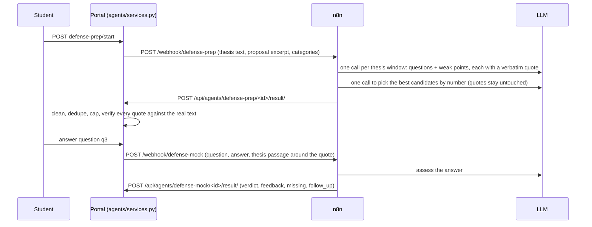

# Agent 5: defense prep

The defense-prep agent helps a student get ready for the thesis defense. It reads the student's thesis
(and the proposal it was built on), lists the questions examiners are likely to ask and the weak points
they are likely to raise, and runs a mock Q&A where the student types answers and gets feedback.

It follows the same rules as the other four agents:

- **Human in the loop.** It only gives advice. It never calls `perform()` and never changes the case.
- **The portal works without it.** If n8n or the model is down, the student sees an agent error and a retry button.
- **The portal never talks to the LLM directly.** Everything goes through n8n webhooks and comes back to `/api/agents/…` with `X-Agent-Token`.

## Who sees it, and when

| | |
|---|---|
| Who | Only the case **author**. The advisor, referees, head and edu staff do not see it, so practice answers stay private. In shadow mode only edu staff and superusers see it (to compare), and nobody can practice. |
| When | Once a thesis version exists and the case is in `in_progress`, `thesis_advisor_review`, `thesis_submitted` or `defense_scheduled`. Closed cases do not show it. |
| Trigger | Manual. The student presses **آماده‌سازی دفاع** on the case page. It does not run on upload, because reading a whole thesis with a local model takes minutes. |

## Flow

## Guarding against made-up content

1. Every question and weak point must quote the thesis (or, for proposal gaps, the proposal).
2. The final "select" step returns only candidate **numbers**, so it cannot invent new quotes.
3. The portal searches each quote in the real extracted text (`agents/defense.py:find_quote`): exact match after
   normalising Persian text (ZWNJ, Arabic ی/ک, Persian digits, punctuation), then a fuzzy match that allows about one word in four to differ.
   Items whose quote is not found are kept but labelled **شاهد در متن پیدا نشد** and sorted last.
4. The quote's position is used to send the matching thesis passage to the mock Q&A, so feedback is grounded in the
   part of the thesis the question came from.

## Question categories

Defined once in `agents/defense.py` (`CATEGORIES`); n8n builds its prompt from the payload.

| key | label |
|---|---|
| `method` | روش و طراحی |
| `evaluation` | ارزیابی و نتایج |
| `novelty` | نوآوری و کارهای مرتبط |
| `proposal_gap` | فاصله‌ی پیشنهاد و پایان‌نامه |
| `limitations` | محدودیت‌ها و کارهای آینده |
| `general` | anything else the model returns |

## Files

| File | What it holds |
|---|---|
| `agents/defense.py` | categories, limits, quote matching (pure functions) |
| `agents/models.py` | `DefensePrep` (one per thesis version), `MockAnswer` (one per practice turn) |
| `agents/services.py` §5 | request/save functions and visibility rules |
| `agents/views.py`, `agents/api.py`, `agents/urls.py` | student page, start/answer endpoints, n8n result endpoints |
| `agents/templates/agents/defense_prep.html`, `_defense_card.html` | the page and the card on the case page |
| `n8n/workflows/05-defense-prep.json`, `06-defense-mock.json` | the two n8n workflows |
| `agents/test_defense.py` | 25 tests (quote matching, payloads, filtering, visibility, mock Q&A, shadow mode) |

## Setup

Run `bash n8n/import.sh` again: it now imports and activates six workflows. No new environment variables are
required. Optional n8n variables: `DEFENSE_WINDOW_CHARS` (default 6000) and `DEFENSE_PROPOSAL_CHARS` (default 2500);
add them to the `n8n` service in `docker-compose.yml` if you want to change them.

## Evaluating it (phase 5)

`DefensePrep.questions` keeps each question with its category, quote and `verified` flag, so two numbers come
straight from the database: the share of verified quotes (hallucination rate), and coverage of categories. For
question quality, ask the advisor to mark which generated questions were actually asked in the real defense.
