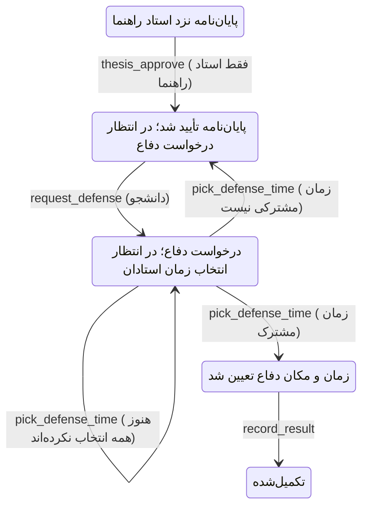

# جریان دفاع: تأیید پایان‌نامه، درخواست دفاع و انتخاب زمان استادان

از ۸ نوامبر ۲۰۲۶ (۱۷ آبان ۱۴۰۵) جریان پس از نوشتن پایان‌نامه این است:

1. **دانشجو** پایان‌نامه را بارگذاری و برای استاد راهنما ارسال می‌کند (`submit_thesis`).
2. **استاد راهنما** آن را با امضای الکترونیک تأیید می‌کند (`thesis_approve`). **تأیید داور لازم نیست.**
   پایان‌نامه فقط **برای مشاهده** به **کارشناس آموزش** و **داور(ان)** فرستاده می‌شود و هر دو اعلان می‌گیرند.
   داور پیش از این تأیید پایان‌نامه را نمی‌بیند و پس از آن هم دکمه‌ی تأیید یا جای نظر روی پایان‌نامه ندارد.
3. **دانشجو** «درخواست دفاع» می‌دهد (`request_defense`): ۲ تا ۵ روز شمسی و محل برگزاری دفاع.
4. **استاد راهنما** (`advisor_pick_defense_time`) و **هر داور** (`referee_pick_defense_time`) از میان همان روزها،
   هر روز و ساعتی را که آزادند انتخاب می‌کنند. ساعت‌های هر روز ثابت‌اند: ۹، ۱۱، ۱۴ و ۱۶.
5. وقتی آخرین استاد انتخاب کرد، **سامانه زودترین زمانی را که برای همه آزاد است** روز و ساعت دفاع می‌کند
   (`rules.first_common_slot`) و پرونده به «زمان و مکان دفاع تعیین شد» می‌رود.
6. **کارشناس آموزش** (و دانشجو، استاد راهنما و داوران) اعلان می‌گیرد که دفاع چه روزی، چه ساعتی و کجاست.
   همین اطلاع در صفحه‌ی پرونده، کادر «زمان‌بندی دفاع»، هم دیده می‌شود.
7. اگر **زمان مشترکی نباشد**، پرونده به «پایان‌نامه تأیید شد؛ در انتظار درخواست دفاع» برمی‌گردد. دانشجو در کادر زرد
   زمان‌های آزاد هر استاد را می‌بیند و روزهای دیگری پیشنهاد می‌دهد.
8. از روز دفاع به بعد، استاد راهنما نتیجه و نمره را ثبت می‌کند (`record_result`)؛ بدون تغییر.

آموزش دانشکده دیگر زمان دفاع را دستی تعیین نمی‌کند؛ گذار `schedule_defense` حذف شد و برچسبش فقط برای
تاریخچه‌ی پرونده‌های قدیمی مانده است.

## قواعد درخواست دفاع (`workflow/rules.py`)

| قاعده | مقدار |
|---|---|
| تعداد روزهای پیشنهادی | `DEFENSE_MIN_DAYS` تا `DEFENSE_MAX_DAYS` (۲ تا ۵)، بدون تکرار |
| زودترین روز | امروز، و نه پیش از «تصویب نهایی + ۳ ماه» (`earliest_defense_day`) |
| دورترین روز | ۶۰ روز پس از زودترین روز (`DEFENSE_HORIZON_DAYS`) |
| روز تعطیل | جمعه پذیرفته نمی‌شود (`NO_DEFENSE_WEEKDAYS`) |
| ساعت‌های هر روز | `DEFENSE_TIME_SLOTS = ("09:00", "11:00", "14:00", "16:00")` |
| انتخاب استاد | حداقل یک زمان، فقط از میان زمان‌های همان درخواست، هر استاد یک بار برای هر درخواست |
| نتیجه | زودترین زمان در اشتراک انتخاب‌های همه‌ی استادان (راهنما + همه‌ی داوران) |

## ماشین‌حالت

## داده

- `ProjectCase.defense_time` (تازه) کنار `defense_date` و `defense_place`.
- `DefenseRequest`: پرونده، دانشجو، `days` (فهرست تاریخ‌ها)، `place`، `status` (open / scheduled / no_match)،
  `chosen_slot` (مثل `2027-01-10T09:00`). قید `one_open_defense_request_per_case`.
- `DefenseAvailability`: درخواست، استاد، نقش، `slots` (زمان‌های انتخاب‌شده). قید `one_availability_per_professor`.
- مایگریشن: `workflow/migrations/0007_defense_request_and_time_picking.py`.

## کجای کد

| فایل | چه چیزی |
|---|---|
| `workflow/statemachine.py` | گذارهای `request_defense`، `advisor_pick_defense_time`، `referee_pick_defense_time` |
| `workflow/services.py` | `_request_defense`، `_pick_defense_time`، `defense_schedule` (کادر صفحه‌ی پرونده)، دیدن پایان‌نامه برای داور فقط پس از تأیید (`_shared_kinds`)، نظر داور فقط روی پیشنهاد (`can_comment`) |
| `workflow/forms.py` | `RequestDefenseForm` (روزها با تاریخ شمسی) و `PickDefenseTimeForm` (چک‌باکس روز × ساعت) |
| `agents/services.py` | `_informed`: اعلان پایان‌نامه به آموزش و داور، و اعلان روز، ساعت و محل دفاع به آموزش، راهنما، داوران و دانشجو |
| `workflow/management/commands/seed_demo.py` | پرونده‌ی نمونه‌ی `kian.rostami` در وضعیت «درخواست دفاع» (با `--full`) |
| `integration/scenarios.py` | سناریوهای سرتاسری با درخواست دفاع، انتخاب زمان، «زمان مشترکی نیست» و درخواست دوباره |

راهنمای گام‌به‌گام آزمون دستی: `docs/test-guide-fa.md`، گام‌های ۱۳ تا ۱۷ و بخش ۴-۱۱.
