# راهنمای جامع سامانه: معماری، پیاده‌سازی، عامل‌های هوش مصنوعی و فلوها

> این سند برای «مسلط شدن» به کل سامانه نوشته شده است؛ همان چیزی که یک مهندس نرم‌افزار تازه‌وارد باید بداند تا بتواند کد را بخواند، توضیح دهد، از آن دفاع کند و تغییرش دهد.
> هر ادعا به فایل و تابعِ مربوط در مخزن ارجاع داده شده است (مثلاً `workflow/services.py` ← `perform()`). اصطلاحات فنی عمداً انگلیسی مانده‌اند.
> وضعیت کد: شاخه‌ی `main` پس از PR #6 (بازطراحی رابط، نمایشگر سند، نظر روی بخش‌ها و امضای الکترونیک).

## فهرست

1. [تصویر کلی و اصول طراحی](#۱-تصویر-کلی-و-اصول-طراحی)
2. [معماری کل سامانه](#۲-معماری-کل-سامانه)
3. [ماژول‌ها یکی‌یکی: چه کاری، چطور، چرا](#۳-ماژولها-یکییکی-چه-کاری-چطور-چرا)
4. [اتصال پورتال و n8n](#۴-اتصال-پورتال-و-n8n)
5. [عامل‌های هوش مصنوعی](#۵-عاملهای-هوش-مصنوعی)
6. [همه‌ی فلوها (Sequence Diagram)](#۶-همهی-فلوها-sequence-diagram)
7. [مدل داده و پایگاه‌داده](#۷-مدل-داده-و-پایگاهداده)
8. [امنیت و کنترل دسترسی](#۸-امنیت-و-کنترل-دسترسی)
9. [آزمون، سناریوهای سرتاسری و حالت سایه](#۹-آزمون-سناریوهای-سرتاسری-و-حالت-سایه)
10. [نقشه‌ی فایل‌ها](#۱۰-نقشهی-فایلها)
11. [دستورهای کلیدی](#۱۱-دستورهای-کلیدی)
12. [پرسش و پاسخ برای خودآزمایی](#۱۲-پرسش-و-پاسخ-برای-خودآزمایی)
13. [واژه‌نامه](#۱۳-واژهنامه)
14. [محدودیت‌ها و نکته‌های ریز کد](#۱۴-محدودیتها-و-نکتههای-ریز-کد)

**اگر تازه شروع می‌کنید:** اول [پشت صحنه‌ی عامل‌ها به زبان ساده](agents-behind-the-scenes-fa.md) را بخوانید؛ همین مطالب را به شکل داستان قدم‌به‌قدم تعریف می‌کند.

**مسیر پیشنهادی مطالعه:** بخش ۱ و ۲ را بخوانید، بعد هم‌زمان با بخش ۳ این فایل‌ها را به همین ترتیب باز کنید: `workflow/enums.py` ← `workflow/rules.py` ← `workflow/statemachine.py` ← `workflow/models.py` ← `workflow/services.py` ← `workflow/views.py`. سپس بخش ۴ و ۵ را با `agents/services.py` و چهار فایل `n8n/workflows/*.json` (در خود n8n باز کنید تا گره‌ها را ببینید). در پایان فلوهای بخش ۶ را یکی‌یکی در پورتال اجرا کنید (`seed_demo --full`).

---

## ۱. تصویر کلی و اصول طراحی

### ۱-۱. سامانه چه می‌کند؟

گردش‌کار کامل **پروژه‌ی کارشناسی** دانشکده‌ی مهندسی کامپیوتر (از انتخاب استاد راهنما تا ثبت نمره) را در یک پورتال وب پیاده می‌کند، طبق «فرم پیشنهاد پروژه کارشناسی» و رویه‌ی AUT-PR-3210. چهار عامل هوش مصنوعی کنار این گردش‌کار کار می‌کنند و **فقط پیشنهاد می‌دهند**:

| عامل | چه کمکی می‌کند | به چه کسی |
|---|---|---|
| اعتبارسنجی سند | بررسی قالب پیشنهاد/پایان‌نامه هنگام بارگذاری (کدام بخش‌ها جا مانده) | دانشجو |
| دستیار آیین‌نامه (RAG) | پاسخ به پرسش‌های آیین‌نامه‌ای با استناد به بند | همه |
| تطبیق استاد | رتبه‌بندی استاد راهنما (برای دانشجو) و داور (برای مدیر گروه) | دانشجو، مدیر گروه |
| اطلاع‌رسانی | نوشتن و ارسال ایمیل تغییر وضعیت و یادآوری مهلت | همه‌ی ذی‌نفعان |

### ۱-۲. سه اصل که کل کد بر آن‌ها بنا شده

1. **انسان‌در‌حلقه (Human-in-the-loop).** هیچ عاملی وضعیت پرونده را تغییر نمی‌دهد. تنها راه تغییر وضعیت تابع `perform()` در `workflow/services.py` است و کد عامل‌ها (`agents/`) هیچ‌جا آن را صدا نمی‌زند. خروجی عامل فقط «نمایش» داده می‌شود: چک‌لیست، فهرست رتبه‌بندی‌شده، پاسخ، ایمیل. حتی در فرم انتخاب داور هیچ گزینه‌ای از پیش تیک نخورده است.
   *چرا؟* مدل زبانی خطا می‌کند و تصمیم آموزشی (پذیرش، رد، نمره) باید پاسخ‌گو داشته باشد. این اصل در `workflow/statemachine.py` هم نوشته شده: «هیچ عامل هوش مصنوعی actor نیست».
2. **پورتال بدون عامل‌ها هم کامل کار می‌کند (Graceful degradation).** با `AGENTS_ENABLED=False` پورتال دقیقاً همان پورتال فاز ۲ است. اگر n8n یا مدل خاموش باشد، فقط همان عامل «انجام نشد» نشان می‌دهد و گردش‌کار ادامه دارد.
   *چرا؟* هسته‌ی سامانه (گردش‌کار اداری) نباید به یک سرویس احتمالاً ناپایدار (LLM محلی) وابسته باشد.
3. **قاعده در پورتال، زبان در n8n (Deterministic core, probabilistic edge).** هر چیزی که باید «دقیق» باشد (چه کسی داور واجد شرایط است، چه مهلتی سررسید شده، ایمیل به چه کسی برود، رتبه از روی چه عددی ساخته شود) در جنگو با قاعده‌ی قطعی حساب می‌شود. مدل زبانی فقط کار «زبانی» می‌کند: تشخیص بخش در متن، جمله‌بندی پاسخ و ایمیل، توجیه یک‌جمله‌ای.
   *چرا؟* بخش قطعی قابل‌آزمون است (۱۶۷ آزمون خودکار) و بخش احتمالاتی به حداقل و در جای قابل‌مشاهده (n8n) محدود می‌شود.

یک قاعده‌ی چهارم هم در عمل رعایت شده: **پورتال هیچ‌وقت مستقیم با مدل زبانی حرف نمی‌زند**؛ همه‌ی فراخوانی‌های AI از n8n می‌گذرد (`agents/n8n.py` تنها نقطه‌ی تماس است).

### ۱-۳. پشته‌ی فناوری (Tech stack)

| لایه | فناوری | چرا این |
|---|---|---|
| وب و منطق | Django 6.1 (Python) | auth، admin، ORM، migrations و فرم آماده؛ مناسب پورتال اداری نقش‌محور |
| پایگاه‌داده | PostgreSQL 16 + افزونه‌ی **pgvector** (ایمیج `pgvector/pgvector:pg16`) | یک پایگاه‌داده برای هم داده‌ی رابطه‌ای و هم پایگاه دانش برداری RAG؛ نیازی به vector DB جدا (مثل Chroma) نیست |
| هماهنگ‌سازی عامل‌ها | **n8n** (Docker، self-hosted) | گردش‌کارهای AI به‌صورت بصری قابل‌دیدن و اشکال‌زدایی‌اند (بخش Executions)؛ خواسته‌ی پروپوزال |
| مدل‌ها | **Ollama** محلی: `gemma3:4b` (گفتگو) و `bge-m3` (embedding چندزبانه) | رایگان، بدون کلید، داده از دانشگاه خارج نمی‌شود؛ چون API سازگار با OpenAI است با عوض‌کردن سه متغیر به هر سرویس ابری وصل می‌شود |
| ایمیل آزمایشی | **Mailpit** | صندوق SMTP محلی؛ ایمیل‌ها در `http://localhost:8025` |
| اسناد | `pypdf`، `python-docx`، `reportlab`، `Pillow` | استخراج متن، ساخت نسخه‌ی امضاشده |
| تاریخ | `jdatetime` | تقویم شمسی برای مهلت‌های آیین‌نامه |
| مرورگر | قالب‌های Django + CSS دست‌نویس + JS کم (`docx-preview` برای نمایش Word) | بدون فریم‌ورک فرانت؛ ساده و RTL-safe |

### ۱-۴. تاریخچه‌ی ساخت (فازها)

| فاز | خروجی | سند |
|---|---|---|
| ۰ | محیط توسعه، اسکلت جنگو | `phases.md` (پوشه‌ی پروژه) |
| ۱ | ماشین‌حالت و مدل داده (`statemachine.py`، `models.py`) | همین سند، بخش ۳ و ۷ |
| ۲ | هسته‌ی پورتال: نقش‌ها، فرم‌ها، داشبوردها، `services.py` | — |
| ۳ | چهار عامل در n8n و اپ `agents` | `docs/phase3.md` |
| ۴ | یکپارچه‌سازی، سناریوهای سرتاسری، حالت سایه، اصلاحات آزمون دستی | `docs/phase4.md`، `docs/reports/` |
| پس از ۴ | بازطراحی رابط (PR #3 تا #6)، درخواست/پذیرش استاد راهنما، نمایشگر سند، نظر روی بخش، امضای الکترونیک | `docs/test-guide-fa.md` |
| ۵ و ۶ | ارزیابی چهارسطحی و نگارش پایان‌نامه | (در پیش) |

---

## ۲. معماری کل سامانه

### ۲-۱. نمودار اجزا (Component diagram)

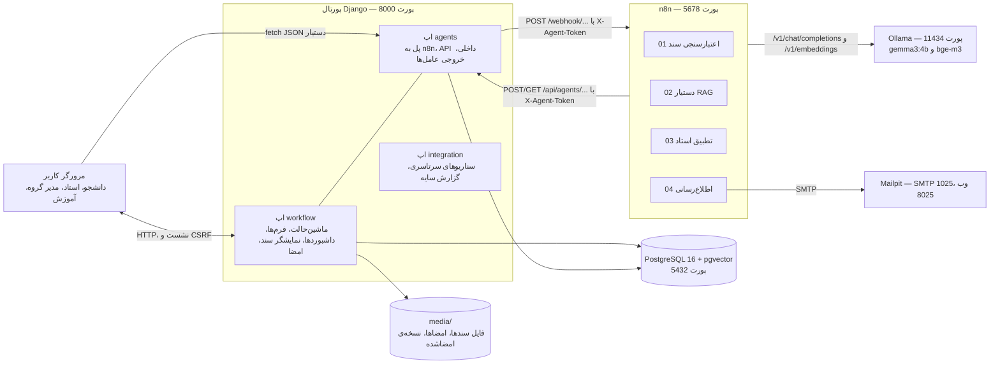

نکته‌ها:
- سه سرویس `db`، `n8n` و `mailpit` در `docker-compose.yml` تعریف شده‌اند؛ جنگو و Ollama روی خود مک اجرا می‌شوند. n8n از درون کانتینر، مک را با نام `host.docker.internal` می‌بیند؛ برای همین در `core/settings.py` این نام به `ALLOWED_HOSTS` اضافه شده است.
- **دو جهت ارتباط** میان پورتال و n8n هست: پورتال Webhookهای n8n را صدا می‌زند، و n8n نتیجه را با API داخلی پورتال برمی‌گرداند (بخش ۴).

### ۲-۲. لایه‌های کد در اپ `workflow` (Layered architecture)

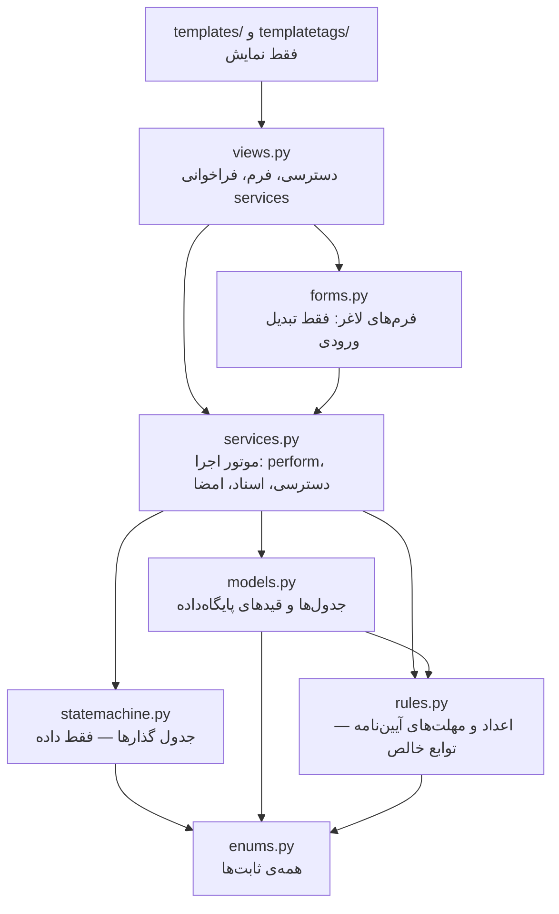

قاعده‌ی وابستگی: هر لایه فقط لایه‌های پایین‌تر را می‌شناسد. `enums.py` و `rules.py` و `statemachine.py` به پایگاه‌داده وابسته نیستند و بدون DB آزمون می‌شوند. **ویوها هرگز `case.state` را مستقیم تغییر نمی‌دهند**؛ فقط `services.perform()` را صدا می‌زنند (docstring بالای `workflow/views.py` و `workflow/services.py`).

### ۲-۳. جدا بودن گردش‌کار و عامل‌ها (Decoupling with events)

موتور گردش‌کار از وجود عامل‌ها خبر ندارد. هر اقدام یک ردیف `CaseEvent` (دفتر رویداد فقط‌افزودنی) ثبت می‌کند و اپ `agents` با **Django signal** به ثبت همین رویدادها گوش می‌دهد:

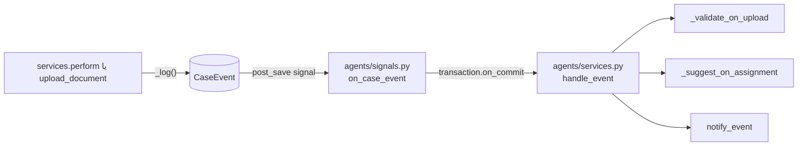

*چرا on_commit؟* اگر اقدام به هر دلیل rollback شود، هیچ عاملی خبردار نمی‌شود و ایمیلی برای اتفاقی که نیفتاده نمی‌رود. *چرا signal؟* تا `workflow/services.py` هیچ `import` از `agents` نداشته باشد و با خاموش‌کردن عامل‌ها چیزی در هسته عوض نشود. (استثنای آگاهانه: `workflow/views.py` و `workflow/forms.py` برای «نمایش» پیشنهادها از `agents.services` می‌پرسند، و قالب‌ها برچسب‌های `agent_tags` را دارند؛ این‌ها فقط نمایش‌اند و وقتی عامل‌ها خاموش‌اند چیزی رسم نمی‌کنند.)

### ۲-۴. محیط اجرا

| سرویس | پورت | از کجا اجرا می‌شود |
|---|---|---|
| Django | 8000 | `python manage.py runserver 0.0.0.0:8000` (باید روی `0.0.0.0` باشد تا n8n از درون Docker به آن برسد) |
| PostgreSQL + pgvector | 5432 | `docker compose up -d` |
| n8n | 5678 | `docker compose up -d`، سپس `bash n8n/import.sh` |
| Mailpit | 8025 (وب)، 1025 (SMTP، فقط درون شبکه‌ی Docker) | `docker compose up -d` |
| Ollama | 11434 | برنامه‌ی Ollama روی مک |

راهنمای کامل نصب: `docs/INSTALL.md`.

---

## ۳. ماژول‌ها یکی‌یکی: چه کاری، چطور، چرا

### ۳-۱. `core/` — تنظیمات و مسیرهای ریشه

- `core/settings.py`: همه‌ی تنظیمات از `.env` خوانده می‌شود (`python-dotenv`). `AUTH_USER_MODEL = 'workflow.User'` (کاربر سفارشی)، زبان `fa`، منطقه‌ی زمانی `Asia/Tehran`، `INSTALLED_APPS` شامل `workflow`، `agents`، `integration`.
- `core/urls.py`: `admin/`، ورود/خروج/تغییر رمز (ویوهای آماده‌ی جنگو)، سپس `agents.urls` و `workflow.urls` هر دو روی ریشه.

متغیرهای محیطی سمت پورتال:

| متغیر | پیش‌فرض | کار |
|---|---|---|
| `DJANGO_SECRET_KEY`، `DEBUG`، `ALLOWED_HOSTS` | — | تنظیمات استاندارد جنگو |
| `DB_NAME`، `DB_USER`، `DB_PASSWORD`، `DB_HOST`، `DB_PORT` | — | اتصال Postgres |
| `AGENTS_ENABLED` | `False` | کلید اصلی لایه‌ی عامل‌ها؛ `False` یعنی هیچ تماسی با n8n |
| `AGENT_TOKEN` | خالی | راز مشترک پورتال و n8n (سرآیند `X-Agent-Token`) |
| `N8N_WEBHOOK_URL` | `http://localhost:5678/webhook` | نشانی Webhookها از دید پورتال |
| `PORTAL_PUBLIC_URL` | `http://localhost:8000` | پیوند داخل ایمیل‌ها و بررسی `agents_check` |
| `AGENTS_SHADOW_MODE` | `False` | حالت سایه (بخش ۹-۳) |
| `AGENTS_SHADOW_MAILBOX` | `shadow@example.com` | مقصد همه‌ی ایمیل‌ها در حالت سایه |

### ۳-۲. اپ `workflow` — هسته‌ی گردش‌کار

#### `workflow/enums.py` — همه‌ی ثابت‌ها در یک‌جا
`UserType` (نوع حساب: دانشجو، هیئت‌علمی، کارشناس آموزش، نویسنده غیردانشجو)، `CaseRole` (نقش زمینه‌ای: author، advisor، head، referee، edu)، `State` (۱۶ وضعیت)، `Semester`، `DocKind` (proposal، thesis)، `ReviewDecision`، `DeadlineKind` (۵ نوع مهلت).
*تفکر پشت آن:* **نوع حساب** ویژگی خودِ کاربر است، ولی **نقش** نسبت به «یک پرونده‌ی مشخص» معنا دارد. یک عضو هیئت‌علمی می‌تواند هم‌زمان راهنمای یک پرونده و داور پرونده‌ی دیگر باشد. پس نقش‌ها در جدول ذخیره نمی‌شوند و هر بار با `ProjectCase.roles_of(user)` محاسبه می‌شوند.

#### `workflow/rules.py` — قواعد و اعداد آیین‌نامه (توابع خالص)
همه‌ی اعداد آیین‌نامه این‌جاست تا اگر آیین‌نامه عوض شد فقط همین فایل ویرایش شود:

| ثابت | مقدار | منبع |
|---|---|---|
| `PROPOSAL_SUBMISSION_MONTHS` | ۲ | توضیح ۱ فرم: تحویل پیشنهاد حداکثر ۲ ماه پس از ثبت‌نام |
| `GROUP_REVIEW_MONTHS` | ۲ | توضیح ۲: داوری در گروه حداکثر ۲ ماه |
| `MAX_ADVISEES` | ۲ | ظرفیت هر استاد راهنما (افزوده پس از آزمون دستی) |
| `MIN_MONTHS_APPROVAL_TO_DEFENSE` | ۳ | توضیح ۴: حداقل ۳ ماه از تصویب تا دفاع |
| `THESIS_LEAD_WEEKS` | ۳ | توضیح ۴: تحویل پایان‌نامه ۳ هفته پیش از مهلت نمره |
| `REFEREES_FOR_STUDENT` / `_NON_STUDENT` | ۱ / ۲ | نویسنده غیردانشجو حداقل دو داور |
| `REMINDER_DAYS` | (۱۴، ۷، ۳، ۱، ۰) | مراحل یادآوری مهلت |
| `OVERDUE_REPEAT_DAYS` | ۷ | تکرار هفتگی هشدار پس از مهلت |

توابع: `add_months()` (ماه تقویمی، نه ۳۰ روز)، `countdown()` (تایمر «X ماه و Y روز مانده»)، `grade_entry_deadline()` (توضیح ۳: نیم‌سال اول/تابستان ← ۳۰ مهر سال بعد؛ نیم‌سال دوم ← ۳۱ فروردین سال بعد، با `jdatetime`)، `thesis_delivery_deadline()`، `current_term()`، و `reminder_stage()` که روزهای مانده را به مرحله‌ی `d14`/`d7`/`d3`/`d1`/`d0`/`overdue1`/`overdue2`/… تبدیل می‌کند.
*نکته‌ی طراحی:* `reminder_stage` بازه‌ای است (۸ تا ۱۴ روز مانده ← `d14`)؛ اگر سامانه یک روز خاموش باشد، یادآوری همان مرحله روز بعد جبران می‌شود و چون هر مرحله برای هر گیرنده یک‌بار ثبت می‌شود، تکراری هم نمی‌رود.

#### `workflow/statemachine.py` — ماشین‌حالت به‌صورت «جدول داده»
هر گذار یک `Transition` (dataclass فریز) است با: `action`، `label`، `actor` (نقش زمینه‌ای)، `sources`، `targets`، `note_required`، `guards` و `effects` (متن، برای مستندسازی). دیکشنری `TRANSITIONS` **تنها منبع حقیقت** قواعد گذار است: چه کسی، در چه وضعیتی، چه اقدامی، به کجا. `ACTION_TONES` رنگ دکمه را از معنای اقدام می‌گیرد (approve سبز، return نارنجی، reject قرمز). توابع `to_mermaid()` و `to_markdown_table()` مستند را **از روی خود کد** می‌سازند (دستور `export_statemachine`).
*چرا جدول و نه if/else؟* قواعد یک‌جا و خوانا هستند، از روی آن‌ها نمودار و جدول مستند ساخته می‌شود، و آزمون می‌تواند بپرسد «آیا همه‌ی وضعیت‌ها قابل‌دسترس‌اند؟» (`reachable_states()`).

۱۸ گذار ماشین‌حالت:

| # | `action` | نقش | از | به | توضیح الزامی |
|---|---|---|---|---|---|
| 1 | `select_advisor` | دانشجو | ADVISOR_SELECTION | ADVISOR_PENDING | — |
| 2 | `advisor_accept` | استاد راهنما | ADVISOR_PENDING | DRAFTING | — |
| 3 | `advisor_decline` | استاد راهنما | ADVISOR_PENDING | ADVISOR_SELECTION | بله |
| 4 | `submit_proposal` | دانشجو | DRAFTING | ADVISOR_REVIEW | — |
| 5 | `advisor_return` | استاد راهنما | ADVISOR_REVIEW | DRAFTING | بله |
| 6 | `advisor_approve` | استاد راهنما | ADVISOR_REVIEW | EDU_REGISTRATION | — (امضا لازم) |
| 7 | `edu_register` | آموزش | EDU_REGISTRATION | REFEREE_ASSIGNMENT | — |
| 8 | `assign_referees` | مدیر گروه | REFEREE_ASSIGNMENT | REFEREE_REVIEW | — |
| 9 | `submit_review` | داور | REFEREE_REVIEW | REFEREE_REVIEW / REVISION / COUNCIL_APPROVAL | فقط برای رأی «اصلاح» |
| 10 | `resubmit_proposal` | دانشجو | REVISION | REFEREE_REVIEW | — |
| 11 | `council_approve` | آموزش | COUNCIL_APPROVAL | IN_PROGRESS | — |
| 12 | `council_reject` | آموزش | COUNCIL_APPROVAL | REJECTED | بله |
| 13 | `submit_thesis` | دانشجو | IN_PROGRESS | THESIS_ADVISOR_REVIEW | — |
| 14 | `thesis_return` | استاد راهنما | THESIS_ADVISOR_REVIEW | IN_PROGRESS | بله |
| 15 | `thesis_approve` | استاد راهنما | THESIS_ADVISOR_REVIEW | THESIS_SUBMITTED | — (امضا لازم) |
| 16 | `schedule_defense` | آموزش | THESIS_SUBMITTED | DEFENSE_SCHEDULED | — |
| 17 | `record_result` | استاد راهنما | DEFENSE_SCHEDULED | COMPLETED | — |
| 18 | `cancel` | آموزش | همه‌ی وضعیت‌های فعال | CANCELLED | بله |

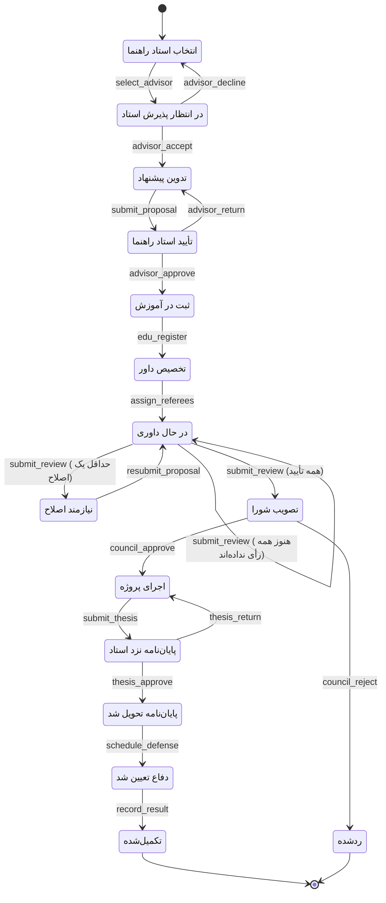

(گذار `cancel` از هر وضعیت فعال به CANCELLED برای خوانایی رسم نشده است.)

تاریخچه‌ی تغییر ماشین‌حالت (در migrations): `0002` لغو پیش از انتخاب استاد را مجاز کرد؛ `0003` وضعیت ADVISOR_PENDING (درخواست و پذیرش) را افزود و مرحله‌ی «تصویب در گروه» را حذف کرد؛ `0004` پرونده‌های قدیمی آن مرحله را به COUNCIL_APPROVAL برد؛ `0005` جدول‌های نظر و امضا را ساخت.

#### `workflow/models.py` — جدول‌ها
`Department`، `User` (سفارشی: `user_type`، `department`، `is_department_head`، `student_number`، `expertise`)، `ProjectCase` (پرونده)، `RefereeAssignment`، `DocumentVersion`، `DocumentComment`، `Signature`، `Review`، `Deadline`، `CaseEvent`. جزئیات و قیدها در بخش ۷.
روش‌های مهم `ProjectCase`:
- `roles_of(user)` — نقش‌های زمینه‌ای کاربر در همین پرونده (از کش prefetch استفاده می‌کند تا داشبورد برای هر پرونده کوئری جدا نزند).
- `is_graded`، `required_referees` — قاعده‌ی نویسنده غیردانشجو (بدون نمره، دو داور).
- `expected_deadlines()` و `sync_deadlines()` — مهلت‌ها همیشه از روی تاریخ‌های رویدادی پرونده محاسبه و پس از هر گذار هماهنگ می‌شوند.
`CaseEvent.save()` و `.delete()` ویرایش و حذف را ممنوع می‌کنند: **دفتر رویداد فقط‌افزودنی (append-only audit log)**.

#### `workflow/services.py` — موتور اجرا (مهم‌ترین فایل هسته)
**`perform(case, action, actor, note, **payload)`** تنها جایی است که وضعیت عوض می‌شود. گام‌ها، همه در یک تراکنش (`@transaction.atomic`):

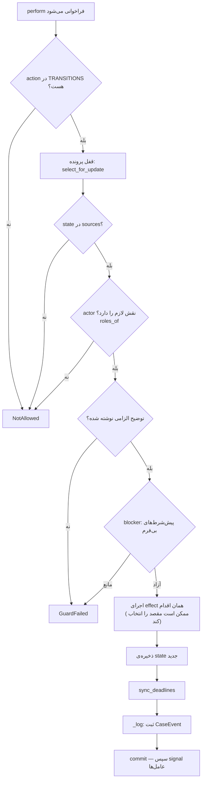

- **دو نوع خطا:** `NotAllowed` (نقش یا وضعیت نادرست) و `GuardFailed` (پیش‌شرط برقرار نیست). متن هر دو فارسی و قابل‌نمایش روی فرم است. در هر دو حالت هیچ تغییری نمی‌ماند (rollback).
- **`select_for_update`** دو اقدام هم‌زمان روی یک پرونده (مثلاً دو داور با هم رأی بدهند) را سریالی می‌کند.
- **`_EFFECTS`** برای هر اقدام یک تابع اثر دارد: `_select_advisor` (بررسی ظرفیت، تنظیم advisor و department)، `_advisor_decline` (پاک‌کردن آن‌ها)، `_edu_register` (`edu_received_at`، برآورده‌کردن مهلت تحویل پیشنهاد و پرچم `late`)، `_assign_referees` (حداقل تعداد، `full_clean` هر تخصیص)، `_submit_review` (ثبت رأی؛ اگر همه رأی نداده‌اند همان وضعیت، اگر یک «اصلاح» ← REVISION، وگرنه ← COUNCIL_APPROVAL)، `_council_approve`، `_thesis_approve`، `_schedule_defense` (دفاع ≥ تصویب + ۳ ماه)، `_record_result` (نمره ۰ تا ۲۰ فقط برای دانشجو).
- **`blocker()` و `available_actions()`**: همان پیش‌شرط‌ها پیش از نمایش دکمه بررسی می‌شوند؛ اگر مانعی باشد دکمه غیرفعال و دلیلش کنارش نوشته می‌شود (`Offer.blocked`). `Offer.waiting` یعنی مانع فقط با گذشت زمان رفع می‌شود (روز دفاع نرسیده). `is_pending_for()` ستون «در انتظار اقدام شما»ی داشبورد را می‌سازد.
- **دسترسی:** `cases_for(user)` پایه‌ی کنترل دسترسی همه‌ی صفحه‌هاست؛ `visible_versions()` و `can_download()` نسخه‌های پیشین را فقط به نویسنده، استاد راهنما و آموزش نشان می‌دهند؛ `visible_events()` همین را روی تاریخچه اعمال می‌کند.
- **`pending_feedback()`**: کادر زرد «نظر بازگشت» برای دانشجو، فقط وقتی آخرین تغییر وضعیت همان بازگشت باشد (با ارسال دوباره ناپدید می‌شود).
- **عملیات بدون تغییر وضعیت:** `create_case` (یک پرونده‌ی فعال در هر نیم‌سال)، `edit_case`، `upload_document` (شماره‌ی نسخه‌ی بعدی، رویداد `upload_proposal`/`upload_thesis` با `version_id` — همین رویداد عامل اعتبارسنجی را بیدار می‌کند).
- **بررسی سند در نمایشگر:** `doc_decision()` (چه تصمیمی با این کاربر است: جدول `_DOC_DECISIONS` از (نقش، وضعیت، نوع سند) به جفت اقدام تأیید/بازگرداندن)، `can_comment()`، `add_comment()`، و **`decide_document()`**: تأیید فقط با تصویر امضا (PNG/JPG، حداکثر ۲ مگابایت) ← `perform()` ← ساخت `Signature` ← `signing.sign_version()`. بازگرداندن بدون توضیح هم ممکن است، به شرطی که استاد روی بخش‌ها نظر گذاشته باشد؛ آن نظرها خودکار توضیح بازگشت می‌شوند (`_comments_note`).

#### `workflow/forms.py` — فرم‌های «لاغر»
فرم‌ها فقط ورودی را می‌گیرند و به نوع درست تبدیل می‌کنند؛ قواعد فقط در `services.py` بررسی می‌شود تا برای فرم وب، پنل ادمین و سناریوها یکسان باشد. `ActionForm` پایه است و `note_required` را از خود Transition می‌خواند. زیرکلاس‌ها: `SelectAdvisorForm` (رادیو، فهرست استادان با ظرفیت خالی، ترتیب پیشنهادی AI)، `AssignRefereesForm` (چک‌باکس، ترتیب پیشنهادی AI)، `ReviewForm`، `ScheduleDefenseForm` (`JalaliDateField`: کاربر تاریخ شمسی تایپ می‌کند)، `RecordResultForm`. `_ranked()` فهرست را به ترتیب رتبه‌ی عامل مرتب می‌کند اما **هیچ گزینه‌ای را از پیش انتخاب نمی‌کند**.

#### `workflow/views.py` — ویوها
هر ویو سه کار می‌کند: پرونده را فقط از `cases_for` برمی‌دارد (پرونده‌ی دیده‌نشدنی = ۴۰۴)، فرم را نشان/اعتبارسنجی می‌کند، کار اصلی را به services می‌سپارد.

| مسیر (`workflow/urls.py`) | ویو | کار |
|---|---|---|
| `/` | `dashboard` | سه داشبورد جدا بر اساس نقش (`dashboard_student/faculty/edu.html`) |
| `/projects/` | `project_list` | فهرست همه‌ی پروژه‌ها با جست‌وجو و فیلتر (فقط آموزش و ادمین) |
| `/cases/new/` | `case_create` | ثبت پرونده |
| `/cases/<pk>/` | `case_detail` | صفحه‌ی پرونده: نوار مرحله‌ها، باکس دو سند، نمایشگر کناری (`?doc=`)، تاریخچه، مهلت‌ها |
| `/cases/<pk>/do/<action>/` | `case_action` | **یک ویو برای همه‌ی گذارها**: فرم مناسب (`action_form_class`) + `perform()`؛ تأیید سند را به نمایشگر امضا هدایت می‌کند |
| `/cases/<pk>/upload/` | `document_upload` | بارگذاری نسخه (PDF/DOC/DOCX، حداکثر ۱۰ مگابایت) |
| `/documents/<pk>/view/` | `document_inline` | فایل برای نمایش درون نمایشگر (`?signed=1` نسخه‌ی امضاشده) |
| `/documents/<pk>/download/` | `document_download` | دانلود با کنترل دسترسی |
| `/documents/<pk>/comments/` | `document_comment` | نظر روی یک بخش |
| `/documents/<pk>/decide/` | `document_decide` | تأیید با امضا / بازگرداندن |
| `/signatures/<pk>/image/` و `/signed/` | `signature_image`، `signed_download` | تصویر امضا و دانلود نسخه‌ی امضاشده |

داشبوردها: دانشجو (پرونده‌ی جاری، نوار پنج‌مرحله‌ای `PHASES`، تایمر مهلت تحویل پیشنهاد و پایان‌نامه، کارت دفاع)؛ هیئت‌علمی (کارت یادآور «منتظر بررسی شما» با تعداد روز انتظار، دانشجویانی که راهنمایی می‌کنم، پرونده‌هایی که داوری می‌کنم، ظرفیت ۲/۲، و بخش مدیر گروه)؛ آموزش (نمودار تعداد پرونده در هر مرحله، مهلت‌های گذشته، آمار کل).

#### فایل‌های کمکی `workflow`
- `viewer.py`: متن سند را (با همان `agents/extract.py`) به «بخش‌ها» می‌شکند؛ مرز بخش‌ها با همان تشخیص عنوانِ قطعه‌بندی RAG (`agents/chunking.heading_ref`). بخش ۰ یعنی «کل سند». **این کار AI نیست؛ قاعده‌محور است.**
- `signing.py`: قراردادن امضا روی سند. فایل اصلی هرگز تغییر نمی‌کند و نسخه‌ی امضاشده جدا ساخته می‌شود. DOCX: زیر پاراگراف «امضای استاد راهنما»/«امضای داور» در قالب نمونه (و حذف راهنمای «(امضای الکترونیک…»)، وگرنه انتهای سند. PDF: با reportlab یک لایه روی صفحه‌ی آخر (امضاهای بعدی کمی بالاتر). اگر سند قبلاً امضا شده، امضای تازه روی **آخرین نسخه‌ی امضاشده** می‌نشیند تا همه‌ی امضاها در یک فایل باشند. خطا در ساخت فایل، امضا را باطل نمی‌کند.
- `jalali.py`: تبدیل شمسی/میلادی و ارقام فارسی (در DB همه‌چیز میلادی است؛ تبدیل فقط هنگام نمایش و ورود).
- `templatetags/portal.py`: فیلترهای `jalali`، `fa`، `time_left`، `time_left_class` و `static_v` (افزودن `?v=زمان‌تغییر` به CSS تا مرورگر نسخه‌ی کهنه را نخواند).
- `management/commands/`: `seed_demo` (کاربران و پرونده‌های نمونه؛ `--full` یک پرونده در هر وضعیت میانی)، `backdate_case` (بردن تاریخ‌های یک پرونده به گذشته، فقط با DEBUG)، `export_statemachine`.
- `static/workflow/`: CSS، فونت Ravi با ارقام فارسی، قالب‌های نمونه‌ی `proposal-template.docx` و `thesis-template.docx`، و کتابخانه‌های vendored `jszip` و `docx-preview`.

### ۳-۳. اپ `agents` — پل میان گردش‌کار و n8n

| فایل | کار |
|---|---|
| `agents/models.py` | جدول‌های **خروجی** عامل‌ها: `DocumentValidation`، `PolicyChunk` (ستون `VectorField`)، `AssistantMessage`، `SuggestionRun`، `RefereeSuggestion`، `Notification`. پایه‌ی مشترک `_AgentRun` با `requested_at`، `finished_at`، `error`، `model` و منطق `is_waiting`/`is_stale` (بی‌پاسخ پس از ۱۰ دقیقه) |
| `agents/signals.py` | گوش دادن به `CaseEvent` و فراخوانی `handle_event` پس از commit |
| `agents/n8n.py` | **تنها** کلاینت n8n: `post(path, payload, timeout)` با `urllib` استاندارد و سرآیند توکن؛ هر خطا ← `Unavailable`. و `healthy()` (`/healthz`) |
| `agents/api.py` | API داخلی که n8n صدا می‌زند؛ دکوراتور `agent_api` توکن، متد و JSON را بررسی می‌کند |
| `agents/services.py` | منطق سمت پورتال هر چهار عامل: `request_*` (پورتال ← n8n) و `save_*`/`record_*` (n8n ← پورتال)، به‌اضافه‌ی `visible_to` (حالت سایه) |
| `agents/checklist.py` | چک‌لیست قالب پیشنهاد (۸ بخش + ۵ فیلد) و پایان‌نامه (۸ بخش) — فقط داده |
| `agents/extract.py` | استخراج متن PDF/DOCX و یکدست‌سازی فارسی؛ تعمیر ارقام وارونه و پرانتز آینه‌ای PDF راست‌به‌چپ |
| `agents/chunking.py` | قطعه‌بندی سند رویه بر اساس عنوان و شماره‌ی بند (۹۰۰ نویسه) |
| `agents/views.py` | ویوهای کاربری: `assistant_ask` (JSON)، `validation_retry`، `suggestions_refresh`، `advisor_suggestions_request` |
| `agents/templatetags/agent_tags.py` | `validation_box`، `notifications_card`، `assistant_widget`؛ وقتی عامل‌ها خاموش‌اند هیچ چیزی رسم نمی‌کنند |
| `agents/templates/agents/` | `_validation.html`، `_advisor_suggestions.html`، `_referee_suggestions.html`، `_assistant.html`، `_notifications.html` |
| `agents/static/agents/agents.js` | تازه‌سازی خودکار صفحه هر ۵ ثانیه تا رسیدن پاسخ (`data-agent-waiting`) و جعبه‌ی گفتگوی دستیار |
| `agents/knowledge/FORM-PROPOSAL.md` | متن «توضیحات ۱ تا ۵» و شرایط تأیید داور؛ پایگاه دانش پیش‌فرض RAG |
| `agents/management/commands/` | `index_policy`، `agents_check`، `run_reminders` |

### ۳-۴. اپ `integration` — آزمون سرتاسری (بدون جدول)
`scenarios.py` (هفت سناریو، فقط داده)، `runner.py` (اجراکننده با ساعت شبیه‌سازی‌شده، حالت آفلاین/زنده)، `documents.py` (سازنده‌ی DOCX مصنوعی با نقص عمدی و «پاسخ درست» معلوم)، `report.py`، `shadow.py` (مقایسه‌ی خروجی عامل با تصمیم انسان) و دستورهای `run_scenarios` و `shadow_report`. جزئیات در بخش ۹.

### ۳-۵. پوشه‌ی `n8n/`
- `n8n/workflows/01-document-validation.json` (شناسه `pm3DocValidation1`)، `02-rag-assistant.json` (`pm3RagAssistant02`)، `03-referee-suggestion.json` (`pm3RefereeSuggest3`)، `04-notifications.json` (`pm3Notifications04`).
- `n8n/credentials/smtp-mailpit.json`: اعتبارنامه‌ی SMTP (host `mailpit`، port 1025، بدون TLS).
- `n8n/import.sh`: اعتبارنامه و گردش‌کارها را با CLI خود n8n درون کانتینر وارد، Publish و n8n را restart می‌کند. شناسه‌ها ثابت‌اند، پس اجرای دوباره همان گردش‌کار را جایگزین می‌کند.

---

## ۴. اتصال پورتال و n8n

### ۴-۱. دو جهت ارتباط

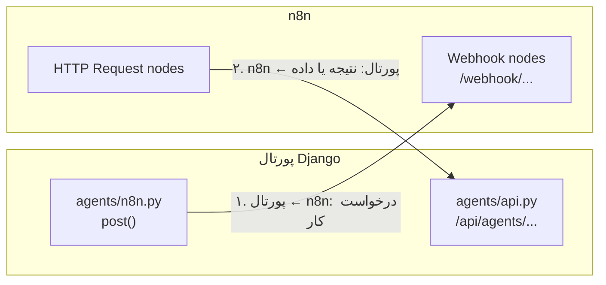

**جهت ۱ — پورتال Webhook n8n را صدا می‌زند** (همه با `agents/n8n.py` ← `post()`):

| Webhook | گردش‌کار | چه کسی صدا می‌زند | حالت پاسخ (`responseMode`) | timeout پورتال |
|---|---|---|---|---|
| `POST /webhook/validate-proposal` | 01 | `agents.services.request_validation` | `onReceived` (ناهم‌زمان) | ۱۰ ثانیه |
| `POST /webhook/rag-ask` | 02 | `agents.services.ask_assistant` | `lastNode` (هم‌زمان) | ۳۰۰ ثانیه |
| `POST /webhook/rag-embed` | 02 | `agents.services.embed` (نمایه‌سازی) | `lastNode` (هم‌زمان) | ۳۰۰ ثانیه |
| `POST /webhook/suggest-referees` | 03 | `agents.services._request_suggestions` | `onReceived` (ناهم‌زمان) | ۱۰ ثانیه |
| `POST /webhook/notify-event` | 04 | `agents.services.notify_event` | `onReceived` (ناهم‌زمان) | ۱۰ ثانیه |
| `POST /webhook/run-reminders` | 04 | دستور `run_reminders` | `onReceived` | ۱۰ ثانیه |
| Schedule Trigger `0 8 * * *` | 04 | خود n8n، هر روز ساعت ۸ | — | — |

**جهت ۲ — n8n API داخلی پورتال را صدا می‌زند** (`agents/urls.py`، `agents/api.py`):

| مسیر | متد | کار | چه کسی |
|---|---|---|---|
| `/api/agents/validations/<id>/result/` | POST | ثبت نتیجه‌ی بررسی قالب ← `save_validation_result` | گردش‌کار 01 |
| `/api/agents/referee-suggestions/<id>/result/` | POST | ثبت رتبه‌بندی استاد ← `save_referee_suggestions` | گردش‌کار 03 |
| `/api/agents/rag/search/` | POST | جست‌وجوی برداری در pgvector ← `search_policy` (این «ابزار» بازیابی عامل RAG است) | گردش‌کار 02 |
| `/api/agents/reminders/due/` | GET | فهرست یادآوری‌های سررسید امروز ← `due_reminders` (`?today=` برای شبیه‌سازی) | گردش‌کار 04 |
| `/api/agents/notifications/` | POST | ثبت نتیجه‌ی ارسال هر ایمیل ← `record_notification` | گردش‌کار 04 |

هیچ‌کدام از این مسیرها وضعیت پرونده را تغییر نمی‌دهند.

### ۴-۲. دو الگوی ارتباط: هم‌زمان و ناهم‌زمان

- **ناهم‌زمان با callback (fire-and-forget):** برای کارهای کند (بررسی سند با چند فراخوانی LLM، تطبیق استاد، ایمیل). Webhook با `responseMode: onReceived` بلافاصله `200` برمی‌گرداند؛ پورتال یک ردیف «در انتظار» (`status=pending`) دارد و صفحه با `agents.js` هر ۵ ثانیه تازه می‌شود. وقتی n8n تمام کرد، نتیجه را به `/api/agents/.../result/` می‌فرستد. اگر تا ۱۰ دقیقه (`STALE_AFTER`) نرسید، «بی‌پاسخ ماند» و دکمه‌ی «بررسی دوباره» نشان داده می‌شود.
  *چرا؟* درخواست کاربر نباید چند دقیقه منتظر یک مدل محلی بماند، و پورتال صف کار (Celery و…) ندارد؛ n8n خودش نقش «کارگر پس‌زمینه» را بازی می‌کند.
- **هم‌زمان (request/response):** برای دستیار RAG (کاربر منتظر پاسخ است) و embedding نمایه‌سازی (دستور خط فرمان). Webhook با `responseMode: lastNode` خروجی آخرین گره را به‌عنوان پاسخ HTTP برمی‌گرداند.

### ۴-۳. احراز هویت: توکن مشترک `X-Agent-Token`

- پورتال ← n8n: `agents/n8n.py` در هر درخواست سرآیند `X-Agent-Token: <AGENT_TOKEN>` را می‌گذارد. **نخستین گره‌ی Code هر گردش‌کار** (مثلاً `Split Into Windows`، `Prepare Question`، `Prepare Candidates`، `Event Items`، `Check Token`) آن را با `$env.AGENT_TOKEN` مقایسه می‌کند و در صورت نابرابری خطای `Unauthorized` می‌دهد.
- n8n ← پورتال: گره‌های HTTP Request همان سرآیند را می‌فرستند. در پورتال دکوراتور `agent_api` در `agents/api.py`: اگر `AGENT_TOKEN` خالی باشد یا توکن برابر نباشد ← `403`؛ مقایسه با `constant_time_compare` (مقاوم در برابر timing attack). این مسیرها `csrf_exempt` هستند چون کاربر انسانی و نشست مرورگر ندارند؛ متد اشتباه ← `405`، بدنه‌ی غیر JSON ← `400`، `AgentError` ← `409`.
- *محدودیت آگاهانه:* توکن مشترک ساده و برای محیط توسعه مناسب است؛ برای استقرار واقعی HTTPS و اعتبارنامه‌های خود n8n لازم است (`docs/phase3.md` بخش ۷).

### ۴-۴. متغیرهای محیطی سمت n8n

`docker-compose.yml` متغیرها را از همان فایل `.env` کنار خود به کانتینر n8n می‌دهد و گره‌ها با `$env.NAME` می‌خوانند:

| متغیر در n8n | از کجا | استفاده |
|---|---|---|
| `AGENT_TOKEN` | `.env` (اجباری؛ بدون آن compose خطا می‌دهد) | بررسی و ارسال توکن |
| `PORTAL_URL` | `PORTAL_INTERNAL_URL` یا پیش‌فرض `http://host.docker.internal:8000` | نشانی پورتال **از دید کانتینر** (با `PORTAL_PUBLIC_URL` فرق دارد) |
| `LLM_BASE_URL`، `LLM_API_KEY`، `LLM_CHAT_MODEL` | `.env` (پیش‌فرض Ollama و `gemma3:4b`) | گره‌های `LLM ...` ← `/chat/completions` |
| `EMBEDDING_BASE_URL`، `EMBEDDING_API_KEY`، `EMBEDDING_MODEL` | `.env` (پیش‌فرض همان سرویس LLM و `bge-m3`) | گره‌های `Embed ...` ← `/embeddings` |
| `VALIDATION_WINDOW_CHARS` | پیش‌فرض ۴۰۰۰ | اندازه‌ی هر تکه‌ی متن در عامل اعتبارسنجی |
| `MAIL_FROM` | پیش‌فرض `portal@example.com` | فرستنده‌ی ایمیل |
| `N8N_BLOCK_ENV_ACCESS_IN_NODE=false` | ثابت در compose | در n8n نسخه‌ی ۲ دسترسی `$env` در گره‌ها پیش‌فرض بسته است |
| `GENERIC_TIMEZONE`، `TZ` | `Asia/Tehran` | تا «ساعت ۸» به وقت تهران باشد |

نکته‌ی عملی (از اجرای زنده، `docs/phase4.md` بخش ۴): `docker compose restart` متغیرهای `.env` را دوباره نمی‌خواند؛ پس از تغییر `.env` باید `docker compose up -d` زد.

**چرا مدل از راه API سازگار با OpenAI صدا زده می‌شود و نه گره‌های AI آماده‌ی n8n؟** گره‌ی ساده‌ی HTTP Request با `/chat/completions` و `/embeddings` با Ollama، OpenAI، OpenRouter و هر سرویس سازگار دیگر کار می‌کند و فقط با عوض‌کردن سه متغیر جابه‌جا می‌شود؛ پرامپت هم دقیقاً در گره‌ی Code دیده و نسخه‌بندی (در JSON گردش‌کار، داخل گیت) می‌شود.

### ۴-۵. چه چیزی عامل‌ها را بیدار می‌کند؟

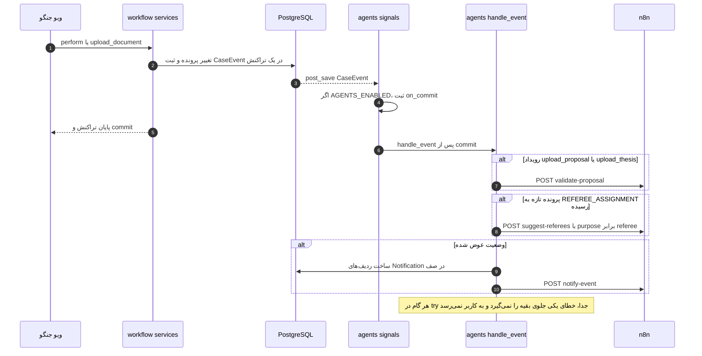

دو ورودی دیگر رویدادمحور نیستند: **پیشنهاد استاد راهنما** با دکمه‌ی خود دانشجو (`advisor_suggestions_request`) و **دستیار RAG** با پرسش کاربر؛ **یادآوری مهلت** هم با زمان‌بندی روزانه‌ی خود n8n.

### ۴-۶. مقاومت در برابر خطا (Resilience)

| لایه | سازوکار | کجا |
|---|---|---|
| پورتال ← n8n | هر خطای شبکه/HTTP/JSON ← `n8n.Unavailable` ← ردیف عامل با `status=error` و پیام فارسی؛ خطا به کاربر پورتال نمی‌رسد | `agents/n8n.py`، `_finish()` |
| انتظار طولانی | `is_stale` پس از ۱۰ دقیقه، دکمه‌ی تلاش دوباره | `agents/models.py` ← `_AgentRun` |
| گره‌های HTTP در n8n | `retryOnFail` (۲ بار، ۳ ثانیه فاصله) | همه‌ی گره‌های HTTP |
| خطای مدل | `onError: continueRegularOutput` در `LLM Check Window`، `Embed Topic And Profiles`، `LLM Explain`، `LLM Compose` و `Send Email`: گردش‌کار متوقف نمی‌شود و گره‌ی بعدی خطا را مدیریت می‌کند | JSON گردش‌کارها |
| متن ایمیل | اگر LLM پاسخ نداد یا متن کوتاه/بلند بود ← متن ثابت پشتیبان (`fallback_body`) | گره‌ی `Finalize Message` |
| توجیه داور | اگر LLM توجیه نداد، رتبه‌بندی (که ریاضی است) بدون توجیه برمی‌گردد | گره‌ی `Build Suggestions` |
| ایمیل ناموفق | وضعیت `failed` ثبت می‌شود و یادآوری ناموفق روز بعد دوباره فرستاده می‌شود | `record_notification`، `due_reminders` |
| خروجی‌های غیرمنتظره | پورتال فقط کلیدهای چک‌لیست خودش و فقط نامزدهای واجد شرایط را می‌پذیرد؛ رتبه را خودش از score می‌سازد | `save_validation_result`، `save_referee_suggestions` |
| مدل‌های «متفکر» | حذف `<think>...</think>` پیش از parse | همه‌ی گره‌های Code پس از LLM |

### ۴-۷. قراردادهای JSON (Payload contracts)

**validate-proposal** — درخواست پورتال:
```json
{
  "validation_id": 12,
  "case": {"id": 5, "title_fa": "…", "title_en": "…"},
  "document": {"version": 2, "kind": "proposal", "kind_label": "پیشنهاد پروژه",
               "chars": 18234, "truncated": false, "text": "متن یکدست‌شده تا ۶۰٬۰۰۰ نویسه"},
  "checklist": [{"key": "introduction", "label": "مقدمه", "hint": "…", "group": "section"}]
}
```
نتیجه‌ی n8n به `/api/agents/validations/12/result/`:
```json
{"found": [{"key": "introduction", "evidence": "۱. مقدمه", "window": 1}],
 "unverified": [{"key": "references", "evidence": "…", "window": 3}],
 "windows": 5, "failed_windows": 0, "model": "gemma3:4b"}
```
یا در صورت شکست همه‌ی تکه‌ها: `{"error": "مدل زبانی پاسخ قابل‌استفاده‌ای نداد.", "detail": "…", "model": "…"}`.

**rag-embed:** درخواست `{"texts": ["…", "…"]}` (دسته‌های ۱۶تایی) ← پاسخ `{"model": "bge-m3", "vectors": [[0.01, …], …]}`.

**rag-ask:** درخواست `{"question": "…"}` ← پاسخ `{"answer": "… [1]", "sources": [{"n": 1, "chunk_id": 7, "score": 0.81, "cited": true}], "model": "gemma3:4b"}`.
**rag/search (ابزار درون rag-ask):** درخواست `{"embedding": [...], "model": "bge-m3", "k": 5}` ← پاسخ `{"chunks": [{"id", "doc", "title", "ref", "text", "score"}]}`.

**suggest-referees:** درخواست
```json
{"run_id": 3, "purpose": "referee", "result_path": "/api/agents/referee-suggestions/3/result/",
 "case": {"id": 5, "title_fa": "…", "title_en": "…", "department": "…"},
 "query_text": "عنوان‌ها + ۲۰۰۰ نویسه‌ی اول مقدمه (یا علایق دانشجو)",
 "candidates": [{"id": 9, "name": "…", "department": "…", "expertise": "…"}],
 "explain_top": 5}
```
نتیجه: `{"suggestions": [{"referee_id": 9, "score": 0.73, "reason": "…"}], "model": "bge-m3 + gemma3:4b"}`.

**notify-event:** درخواست `{"notifications": [{"key": "event:41:9", "to": "…", "subject": "…", "facts": {...}, "fallback_body": "…", "footer": "…"}]}`؛ پاسخ GET `reminders/due` همین شکل را دارد با کلید `reminder:<deadline>:<stage>:<user>`. نتیجه‌ی هر ارسال: `POST /api/agents/notifications/` با `{"key", "status": "sent"|"failed", "subject", "body", "generated_by": "llm"|"template"}`.
*چرا کلید متنی؟* کلید را پورتال می‌سازد و همان کلید برمی‌گردد؛ پس n8n لازم نیست چیزی از ساختار پایگاه‌داده بداند و قید یکتایی جدول `Notification` از ثبت دوباره جلوگیری می‌کند (idempotency).

---

## ۵. عامل‌های هوش مصنوعی

### ۵-۰. نقشه‌ی استفاده از AI در هر بخش پورتال

| بخش پورتال | AI دارد؟ | چه نوع AI | چه چیزی قطعی (بدون AI) است |
|---|---|---|---|
| انتخاب استاد راهنما (دانشجو) | بله | embedding (`bge-m3`) + شباهت کسینوسی + LLM برای توجیه | فهرست استادان با ظرفیت خالی، سقف ۲ دانشجو، خود انتخاب |
| بارگذاری پیشنهاد/پایان‌نامه | بله | LLM (`gemma3:4b`) برای یافتن بخش‌ها با نقل‌قول | استخراج متن، چک‌لیست، راستی‌آزمایی نقل‌قول، تصمیم ارسال |
| تخصیص داور (مدیر گروه) | بله | embedding + کسینوسی + LLM توجیه | داوران واجد شرایط (همان گروه، غیر از راهنما و نویسنده)، حداقل تعداد |
| دستیار آیین‌نامه (همه‌ی صفحه‌ها) | بله | RAG: embedding + pgvector + LLM | قطعه‌بندی سند، بازیابی k نزدیک‌ترین، متن منبع از DB |
| ایمیل تغییر وضعیت و یادآوری | بله | LLM فقط برای جمله‌بندی | گیرندگان، زمان یادآوری، واقعیت‌ها، پانویس، جلوگیری از تکرار |
| نمایشگر سند و بخش‌بندی برای نظر | **خیر** | — | regex تشخیص عنوان (`chunking.heading_ref`) |
| امضای الکترونیک | **خیر** | — | python-docx / reportlab |
| مهلت‌ها، تایمرها، داشبوردها | **خیر** | — | `rules.py` و `services.py` |
| همه‌ی تصمیم‌ها (تأیید، رد، رأی، نمره) | **خیر** | — | فقط انسان، با `perform()` |

مدل‌های پیش‌فرض: **`gemma3:4b`** برای گفتگو (در اجرای زنده `gemma3:1b` برای اعتبارسنجی سند ضعیف بود) و **`bge-m3`** برای embedding (چندزبانه، فارسی را خوب می‌فهمد). همه‌ی فراخوانی‌ها با `temperature: 0` (به‌جز ایمیل: `0.3` برای لحن طبیعی‌تر) تا خروجی تا حد ممکن تکرارپذیر باشد.

راهبردهای مشترک ضد «توهم» (hallucination) در همه‌ی عامل‌ها:
1. **محدود کردن ورودی:** مدل فقط داده‌ای را می‌بیند که پورتال داده است (متن سند، بندهای بازیابی‌شده، تخصص ثبت‌شده، واقعیت‌های پرونده).
2. **خروجی ساخت‌یافته:** `response_format: json_object` و شکل دقیق JSON در پرامپت.
3. **راستی‌آزمایی پس از مدل:** نقل‌قول باید واقعاً در متن باشد؛ کلید باید در چک‌لیست باشد؛ استاد باید نامزد واجد شرایط باشد؛ متن منبع RAG از DB خوانده می‌شود نه از خروجی مدل.
4. **نقش محدود:** پرامپت‌ها صریحاً می‌گویند «نظر نده»، «تصمیم نگیر»، «از خودت اضافه نکن».

---

### ۵-۱. عامل ۱ — اعتبارسنجی سند (Format check)

**هدف:** هنگام بارگذاری، به دانشجو بگوید کدام بخش‌ها یا فیلدهای الزامی فرم در سندش پیدا نشد. **فقط بازخورد است و مانع ارسال نیست.**

**محل کد:**
- پورتال: `agents/services.py` ← `request_validation()`، `save_validation_result()`، `validation_visible_to()`؛ چک‌لیست `agents/checklist.py`؛ استخراج `agents/extract.py`؛ نمایش `agents/templatetags/agent_tags.py` ← `validation_box` و `agents/templates/agents/_validation.html`.
- n8n: `n8n/workflows/01-document-validation.json`.

**تریگر:** رویداد `upload_proposal` یا `upload_thesis` ← `_validate_on_upload` (و دکمه‌ی «بررسی دوباره» ← `validation_retry`). با وجود نام Webhook، برای پایان‌نامه هم کار می‌کند؛ فقط چک‌لیست فرق دارد (`checklist.items_for(kind)`).

**ورودی‌ها:** متن یکدست‌شده‌ی سند (حداکثر ۶۰٬۰۰۰ نویسه) + چک‌لیست. پیشنهاد: ۸ بخش (عنوان، مقدمه، مرور پیشینه، رویکرد، روش ارزیابی، زمان‌بندی، امکانات، مراجع) و ۵ فیلد صفحه‌ی اول (نام، شماره دانشجویی، ایمیل، نیم‌سال، نام استاد راهنما). پایان‌نامه: ۸ بخش (عنوان، چکیده، مقدمه، پیشینه، روش، ارزیابی، جمع‌بندی، مراجع). هر مورد `key` (شناسه‌ی پایدار)، `label`، `hint` (راهنمای مدل) و `group` دارد.

**پیش‌پردازش در پورتال:** اگر فایل DOC قدیمی، رمزدار یا خراب باشد، یا متن کمتر از ۳۰۰ نویسه باشد (PDF اسکن‌شده)، همان‌جا خطای فارسی ثبت می‌شود و چیزی به n8n نمی‌رود.

**گره‌های n8n:**

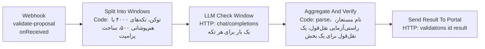

*چرا تکه‌تکه (map-reduce)؟* کل پیشنهاد در پنجره‌ی ورودی مدل‌های کوچک محلی جا نمی‌شود. هر تکه‌ی ۴۰۰۰ نویسه‌ای با چک‌لیست حدود ۱۸۰۰ توکن است (زیر پنجره‌ی ۴۰۹۶ پیش‌فرض Ollama). هم‌پوشانی ۵۰۰ نویسه‌ای نمی‌گذارد عنوانی که روی مرز دو تکه افتاده گم شود. n8n برای هر آیتم ورودی گره‌ی HTTP را جدا اجرا می‌کند، پس «map» رایگان است.

**پرامپت سیستم (گره‌ی `Split Into Windows`):**
```text
تو دستیار بررسی «قالب» سند «پیشنهاد پروژه» کارشناسی دانشکده‌ی مهندسی کامپیوتر دانشگاه صنعتی امیرکبیر هستی.
ورودی: فهرست موارد الزامی فرم و «یک تکه» از متن استخراج‌شده‌ی سند.
وظیفه: مشخص کن کدام موارد فهرست در «همین تکه» وجود دارند.
قواعد:
۱. یک «بخش» فقط وقتی وجود دارد که عنوان آن (یا عنوانی هم‌معنا) در متن آمده و زیر آن دست‌کم یک جمله محتوا نوشته شده باشد.
۲. یک «فیلد» فقط وقتی وجود دارد که مقدارش پر شده باشد؛ برچسبِ بدون مقدار یعنی خالی.
۳. برای هر مورد یافت‌شده، evidence را عیناً و بدون هیچ تغییری از متن رونویسی کن (حداکثر ۱۲ واژه).
۴. درباره‌ی کیفیت علمی نظر نده و حدس نزن؛ اگر مطمئن نیستی آن مورد را نیاور.
خروجی فقط یک شیء JSON با همین شکل باشد و هیچ متن دیگری ننویس:
{"found": [{"key": "<کلید انگلیسی مورد، مثلاً introduction>", "evidence": "<نقل‌قول عینی از متن>"}]}
```
پیام کاربر: «موارد الزامی:» + فهرست `- key (بخش/فیلد): label — hint` + «متن سند (تکه‌ی i از n):» + متن تکه. تنظیمات: `temperature: 0`، `response_format: json_object`.

**منطق `Aggregate And Verify` (قلب ضد توهم این عامل):**
1. `parseJson`: حذف `<think>`، برداشتن از نخستین `{` تا آخرین `}`.
2. **نام مستعار:** مدل‌های کوچک گاهی به‌جای `introduction` برچسب فارسی «مقدمه» را برمی‌گردانند؛ نقشه‌ی `aliases` (کلید، برچسب، و هر جزء برچسب پس از `/`) آن را به کلید درست برمی‌گرداند. (باگی که اجرای زنده پیدا کرد.)
3. **راستی‌آزمایی شاهد (`supported`):** متن نقل‌قول و تکه هر دو یکدست می‌شوند (NFKC، ی/ک عربی، ارقام فارسی، حذف نیم‌فاصله و علائم). نقل‌قول پذیرفته است اگر عیناً در تکه باشد یا دست‌کم ۷۰٪ واژه‌هایش در تکه باشد. وگرنه آن مورد «تأییدنشده» (`unverified`) است، نه «یافت‌شده».
4. **یک نقل‌قول، یک بخش:** اگر مدل یک عنوان را شاهد چند بخش آورده (مثلاً «مراحل انجام و زمان‌بندی» هم برای زمان‌بندی و هم برای روش ارزیابی)، فقط بخشی پذیرفته می‌شود که نامش بیشترین هم‌پوشانی واژگانی را با نقل‌قول دارد. (باگ دوم اجرای زنده: نبودِ «روش ارزیابی» پنهان می‌ماند.)
5. اگر همه‌ی تکه‌ها شکست خوردند ← `{"error": ...}`؛ وگرنه `found`، `unverified`، `windows`، `failed_windows`.

**پس‌پردازش در پورتال (`save_validation_result`):** فقط کلیدهای چک‌لیست خود پورتال پذیرفته می‌شوند؛ برای هر مورد یک یادداشت فارسی ساخته می‌شود («شاهد در متن: «…»»، «مدل این را موجود اعلام کرد اما شاهدش تأیید نشد؛ خودتان بررسی کنید»، «این بخش پیدا نشد»). وضعیت `passed` اگر همه‌ی موارد ok باشند، وگرنه `issues`. اگر بعضی تکه‌ها شکست خورده باشند هشدار «نتیجه ممکن است ناقص باشد».

**چه کسی می‌بیند (`validation_visible_to`):** فقط **نویسنده**، فقط روی **آخرین نسخه**، و فقط تا وقتی مرحله‌ی بارگذاری همان سند باز است (پیشنهاد: DRAFTING/REVISION؛ پایان‌نامه: IN_PROGRESS). پس از «ارسال» دیگر به هیچ‌کس، از جمله استاد راهنما و داور، نشان داده نمی‌شود. در حالت سایه فقط آموزش و ادمین.
*چرا؟* تصمیم محصول در PR #6 (به درخواست بهاران): این نکته‌ها راهنمای دانشجو برای «پیش از ارسال» است؛ نشان‌دادنش به استاد ممکن است داوری انسانی را سوگیرانه کند. (در `docs/phase4.md` بند ۶ نسخه‌ی قدیمی‌تر این قاعده آمده که استاد و داور هم می‌دیدند؛ کد فعلی این را عوض کرده است.)

**نتیجه‌ی اجرای زنده:** با `gemma3:4b` حدود ۹۵٪ (۹۹ از ۱۰۴ مورد روی ۸ سند)؛ ۵ خطا همه «هشدار نادرست» (۴ بار نام استاد راهنما، ۱ بار مراجع). با `gemma3:1b` تقریباً همه «پیدا نشد» (`docs/reports/`).

---

### ۵-۲. عامل ۲ — دستیار آیین‌نامه (RAG)

**هدف:** پاسخ کوتاه به پرسش‌های آیین‌نامه‌ای، **فقط** از روی بندهای نمایه‌شده و با شماره‌ی بند.

**محل کد:**
- پورتال: `agents/services.py` ← `embed()`، `index_document()`، `search_policy()`، `ask_assistant()`، `_sources()`؛ `agents/chunking.py`؛ مدل‌های `PolicyChunk` و `AssistantMessage`؛ ویوی `agents/views.py` ← `assistant_ask`؛ رابط `agents/templates/agents/_assistant.html` و `agents/static/agents/agents.js`؛ دستور `index_policy`.
- n8n: `n8n/workflows/02-rag-assistant.json` با دو Webhook: `rag-embed` و `rag-ask`.

**مرحله‌ی الف — نمایه‌سازی (یک‌بار، با `python manage.py index_policy`):**
1. `extract.extract_text` (PDF/DOCX/MD/TXT).
2. `chunking.split`: متن از روی عنوان‌ها شکسته می‌شود. `heading_ref` این‌ها را عنوان می‌شناسد: سرخط Markdown، کلیدواژه‌های «ماده/بند/تبصره/توضیح/فصل/بخش/پیوست + عدد»، شماره‌ی چندسطحی (`۵-۲`، `4.1.3`)، و شماره‌ی تک‌سطحی در سطر کوتاه. هر قطعه حداکثر ۹۰۰ نویسه (بندهای بلند در مرز جمله شکسته می‌شوند) و قطعه‌های زیر ۴۰ نویسه به قبلی می‌چسبند. برچسب بند (`ref`) کنار هر قطعه می‌ماند تا دستیار بتواند بگوید پاسخ از کجاست.
3. `embed()` متن‌ها را در دسته‌های ۱۶تایی به `rag-embed` می‌فرستد (متن embedding = `ref` + متن).
4. در یک تراکنش، قطعه‌های قبلی همان `doc_code` حذف و تازه‌ها با `bulk_create` ذخیره می‌شوند؛ ستون `embedding_model` نام مدل را نگه می‌دارد.
*چرا `VectorField` بدون بُعد ثابت؟* تا با عوض‌کردن مدل embedding مایگریشن لازم نباشد؛ جست‌وجو همیشه فقط میان قطعه‌هایی است که با **همان مدل** نمایه شده‌اند (و `agents_check` اگر ناهم‌خوان باشند هشدار می‌دهد).
پایگاه دانش فعلی `agents/knowledge/FORM-PROPOSAL.md` است (توضیحات ۱ تا ۵ فرم و شرایط تأیید داور). سند AUT-PR-3210 در مخزن نیست و باید دستی نمایه شود.

**مرحله‌ی ب — پرسش:**

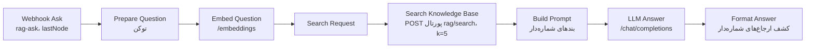

**پرامپت سیستم (گره‌ی `Build Prompt`):**
```text
تو دستیار پاسخ‌گویی به پرسش‌های آیین‌نامه‌ای پروژه‌ی کارشناسی در دانشگاه صنعتی امیرکبیر هستی.
فقط و فقط بر اساس «بندهای مرجع» که در پیام کاربر آمده پاسخ بده.
قواعد:
۱. پاسخ کوتاه، دقیق و به زبان فارسی باشد.
۲. پس از هر مطلبی که از یک بند گرفته‌ای، شماره‌ی همان بند را به شکل [1] یا [2] بیاور.
۳. اگر پاسخ در بندهای مرجع نیست، فقط بنویس: «در اسناد نمایه‌شده پاسخی برای این پرسش پیدا نکردم.» و چیزی از دانسته‌های خودت اضافه نکن.
۴. تصمیم اداری یا علمی نگیر و وعده نده؛ فقط متن آیین‌نامه را توضیح بده.
```
پیام کاربر: «بندهای مرجع:» + `[i] (کد سند — بند)\nمتن` برای ۵ قطعه + «پرسش: …».

**نکته‌های طراحی:**
- **بازیابی در پورتال، نه در n8n:** جست‌وجوی برداری با `CosineDistance` از `pgvector.django` در `search_policy` انجام می‌شود (n8n فقط بردار پرسش را می‌دهد). داده‌ی دانش همان‌جا می‌ماند که بقیه‌ی داده‌هاست و n8n به پایگاه‌داده دسترسی مستقیم ندارد. `k` بین ۱ تا ۱۰ محدود می‌شود و ورودی بردار اعتبارسنجی می‌شود.
- **متن منبع از DB:** n8n فقط `chunk_id` و `score` و `cited` برمی‌گرداند؛ `_sources()` متن واقعی بند را از جدول `PolicyChunk` می‌خواند. پس مدل نمی‌تواند متن منبع جعل کند.
- **`cited`:** گره‌ی `Format Answer` ارجاع‌های `[n]` (با ارقام لاتین یا فارسی) را در پاسخ پیدا می‌کند تا رابط کاربری بندهای استنادشده را متمایز کند.
- **ثبت برای ارزیابی:** هر پرسش (موفق یا ناموفق) با پاسخ، منابع، مدل و زمان پاسخ (`latency_ms`) در `AssistantMessage` ثبت می‌شود؛ داده‌ی سطح ۳ ارزیابی فاز ۵.
- **امنیت رابط:** `agents.js` پاسخ مدل را با `textContent` درج می‌کند، پس خروجی مدل هرگز به‌عنوان HTML اجرا نمی‌شود (جلوگیری از XSS).
- **محدودیت‌ها:** پرسش حداکثر ۵۰۰ نویسه؛ دستیار حافظه‌ی گفتگو ندارد (هر پرسش مستقل است).

---

### ۵-۳. عامل ۳ — تطبیق استاد (پیشنهاد داور و استاد راهنما)

**هدف:** رتبه‌بندی استادان بر پایه‌ی شباهت معنایی «موضوع» با «زمینه‌های تخصصی» ثبت‌شده‌ی هر استاد (`User.expertise`)، به‌اضافه‌ی یک جمله توجیه برای ۵ نفر اول. **انتخاب با انسان است.**

**یک گردش‌کار، دو کاربرد** (فیلد `purpose`):

| | `referee` | `advisor` |
|---|---|---|
| برای چه کسی | مدیر گروه، فرم «تخصیص داور» | دانشجو، فرم «انتخاب استاد راهنما» |
| تریگر | خودکار: ورود پرونده به REFEREE_ASSIGNMENT (`_suggest_on_assignment`)؛ دکمه‌ی «تازه‌سازی» (`suggestions_refresh`) | دستی: دانشجو علایقش را می‌نویسد (۲۰ تا ۱۵۰۰ نویسه) ← `advisor_suggestions_request` |
| متن موضوع | `topic_text()`: عنوان فارسی + انگلیسی + ۲۰۰۰ نویسه از ابتدای «مقدمه»ی آخرین نسخه‌ی پیشنهاد (صفحه‌ی اول فرم برای همه یکسان است، پس از آن رد می‌شود) | عنوان‌ها + متن علایق دانشجو |
| نامزدها (قاعده‌ی قطعی پورتال) | `eligible_referees`: هیئت‌علمی همان گروه، فعال، غیر از راهنما و نویسنده | `eligible_advisors`: هیئت‌علمی فعال با ظرفیت خالی (کمتر از ۲ دانشجو) |

**محل کد:** `agents/services.py` ← `topic_text()`، `candidates_for()`، `_request_suggestions()`، `request_referee_suggestions()`، `request_advisor_suggestions()`، `save_referee_suggestions()`، `suggestion_ranks()`، `suggestion_panel()`؛ `workflow/forms.py` ← `_ranked()` و `_rank_label()`؛ قالب‌ها `_referee_suggestions.html` و `_advisor_suggestions.html`؛ n8n: `n8n/workflows/03-referee-suggestion.json`.

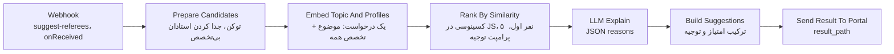

**نکته‌ی کلیدی:** رتبه‌بندی **ریاضی** است (شباهت کسینوسی بردارها در گره‌ی Code: `dot / sqrt(na * nb)`)، نه نظر LLM. LLM فقط «توجیه یک‌جمله‌ای» می‌نویسد و اگر شکست بخورد رتبه‌بندی بدون توجیه برمی‌گردد. استادانی که تخصص ثبت نکرده‌اند با `score: null` و توضیح «تخصص ثبت نشده» در انتهای فهرست می‌آیند.

**پرامپت سیستم (گره‌ی `Rank By Similarity`)، نسخه‌ی داور:**
```text
تو دستیار مدیر گروه برای انتخاب داور پیشنهاد پروژه‌ی کارشناسی هستی.
برای هر استادِ فهرست، در «یک جمله‌ی کوتاه فارسی» بنویس تخصص او چه ارتباطی با موضوع پروژه دارد.
قواعد:
۱. فقط از متن «تخصص» همان استاد استفاده کن و هیچ سابقه یا ویژگی دیگری از خودت نساز.
۲. اگر ارتباط کم است، همین را صادقانه بنویس.
۳. درباره‌ی این‌که چه کسی باید انتخاب شود نظر نده؛ تصمیم با مدیر گروه است.
خروجی فقط یک شیء JSON با همین شکل باشد:
{"reasons": [{"id": <شناسه‌ی عددی استاد>, "reason": "<یک جمله>"}]}
```
نسخه‌ی استاد راهنما همین است با «دستیار دانشجو برای یافتن استاد راهنما» و «تصمیم با خود دانشجوست». پیام کاربر: موضوع (تا ۱۵۰۰ نویسه) + `- id=… | نام | تخصص: …` برای ۵ نفر اول.

**پس‌پردازش در پورتال (`save_referee_suggestions`):** فقط شناسه‌هایی که **همین حالا** نامزد واجد شرایط‌اند ذخیره می‌شوند (اگر در این فاصله ظرفیت استادی پر شده باشد حذف می‌شود)؛ رتبه را خود پورتال از روی `score` می‌سازد؛ توجیه حداکثر ۶۰۰ نویسه. ذخیره در `SuggestionRun` (یک ردیف برای هر پرونده و هدف) و `RefereeSuggestion`.

**نمایش:** کادر «پیشنهاد سامانه» بالای فرم با رتبه، درصد شباهت، **بار کاری** فعلی هر استاد (داوری‌ها یا راهنمایی‌های در جریان) و توجیه. خود فرم به ترتیب رتبه مرتب است و کنار هر نام «(پیشنهاد سامانه: رتبه‌ی n)» آمده، ولی هیچ گزینه‌ای انتخاب‌شده نیست. آزمون `test_ranked_list_is_shown_but_the_student_chooses` همین را می‌سنجد (دانشجو رتبه‌ی دوم را برمی‌گزیند و سامانه می‌پذیرد).

**نتیجه‌ی اجرای زنده:** پیشنهاد استاد راهنما رتبه‌ی ۱ درست؛ پیشنهاد داور ۲ از ۲ سناریو درست (هم با `gemma3:1b` و هم `4b`، چون رتبه را embedding می‌سازد نه LLM).

---

### ۵-۴. عامل ۴ — اطلاع‌رسانی و یادآوری مهلت

**هدف:** ایمیل یک‌طرفه به کسی که اکنون نوبت اقدام اوست و به نویسنده، پس از هر تغییر وضعیت؛ و یادآوری مهلت‌ها.

**محل کد:** `agents/services.py` ← `stakeholders()`، `pending_actions()`، `_notification()`، `build_event_notifications()`، `notify_event()`، `due_reminders()`، `record_notification()`، `visible_notifications()`؛ `workflow/rules.py` ← `reminder_stage()`؛ مدل `Notification`؛ دستور `run_reminders`؛ n8n: `n8n/workflows/04-notifications.json`.

**سه ورودی، یک مسیر مشترک:**

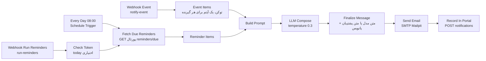

**تقسیم کار دقیق:**
- **پورتال (قطعی):** چه کسی گیرنده است (`stakeholders` که اکنون اقدامی بر عهده دارند + نویسنده، و در پایان پرونده استاد راهنما؛ به‌جز خود اقدام‌کننده و کاربران بی‌ایمیل)، چه زمانی یادآوری برود (`due_reminders`: مهلت‌های باز پرونده‌های فعال، به‌جز «زودترین تاریخ دفاع» که سررسید نیست؛ مرحله با `reminder_stage`؛ هر (مهلت، مرحله، گیرنده) فقط یک‌بار)، موضوع ایمیل، **واقعیت‌ها** (`facts`: نام و نقش گیرنده، عنوان و وضعیت پرونده، اقدام‌های مورد انتظار، چه اتفاقی افتاد، نزدیک‌ترین مهلت)، متن پشتیبان قطعی (`fallback_body`) و پانویس (پیوند پورتال + «پاسخ ندهید»).
- **n8n + LLM (زبانی):** فقط جمله‌بندی پیام از روی همان واقعیت‌ها.

**پرامپت سیستم (گره‌ی `Build Prompt`):**
```text
تو نویسنده‌ی اعلان‌های سامانه‌ی مدیریت پروژه‌ی کارشناسی دانشگاه هستی.
با استفاده از «واقعیت‌ها» یک پیام کوتاه (حداکثر ۴ جمله)، رسمی و مؤدبانه به فارسی برای گیرنده بنویس.
قواعد:
۱. پیام را با «<نام گیرنده> گرامی،» شروع کن.
۲. فقط از واقعیت‌های داده‌شده استفاده کن؛ هیچ تاریخ، مهلت، نام، عدد یا وعده‌ای از خودت اضافه نکن.
۳. اگر your_actions خالی نیست، روشن بگو چه اقدامی از گیرنده انتظار می‌رود؛ اگر خالی است، بگو پیام فقط برای اطلاع است.
۴. پیوند، امضا و جمله‌ی «به این پیام پاسخ ندهید» ننویس؛ سامانه خودش اضافه می‌کند.
خروجی فقط متن پیام باشد، بدون عنوان و بدون توضیح اضافه.
```
پیام کاربر: «واقعیت‌ها:» + JSON واقعیت‌ها.

**`Finalize Message`:** اگر متن مدل بین ۲۰ تا ۱۲۰۰ نویسه بود ← `generated_by: llm`؛ وگرنه `fallback_body` ← `generated_by: template`. پانویس ثابت همیشه افزوده می‌شود. پس خرابی مدل جلوی اطلاع‌رسانی را نمی‌گیرد.

**چرخه‌ی وضعیت اعلان:** پورتال پیش از تماس ردیف‌ها را با `QUEUED` می‌سازد (`bulk_create` با `ignore_conflicts`)؛ اگر n8n در دسترس نباشد ← `FAILED`؛ n8n پس از ارسال ← `SENT` یا `FAILED` با متن نهایی. دو قید یکتایی (رویداد+گیرنده، مهلت+مرحله+گیرنده) از تکرار جلوگیری می‌کنند.

**حالت سایه:** همه‌ی ایمیل‌ها به `AGENTS_SHADOW_MAILBOX` می‌روند و گیرنده‌ی واقعی در موضوع نوشته می‌شود («[سایه ← …]»).

**نکته:** متن نظر داور در ایمیل نمی‌آید (فقط «چه اتفاقی افتاد»)؛ پاسخ دادن به ایمیل هیچ اقدامی ثبت نمی‌کند.

---

## ۶. همه‌ی فلوها (Sequence Diagram)

نقش‌ها و کاربران نمونه‌ی `seed_demo` (رمز همه `test1234`): دانشجو `sara.nouri` (بدون پرونده، برای مسیر کامل)، استاد راهنما `soleiman.fallah`، مدیر گروه `ali.ahmadi`، داوران `mehdi.zakeri` و `narges.rezaei` و …، آموزش `maryam.salehi`، نویسنده غیردانشجو `kamran.shirazi`. با `seed_demo --full` برای هر وضعیت میانی یک پرونده‌ی آماده ساخته می‌شود (`docs/phase4.md` بخش ۲-۶). راهنمای گام‌به‌گام دستی: `docs/test-guide-fa.md`.

### ۶-۰. نمای کل چرخه‌ی عمر یک پرونده

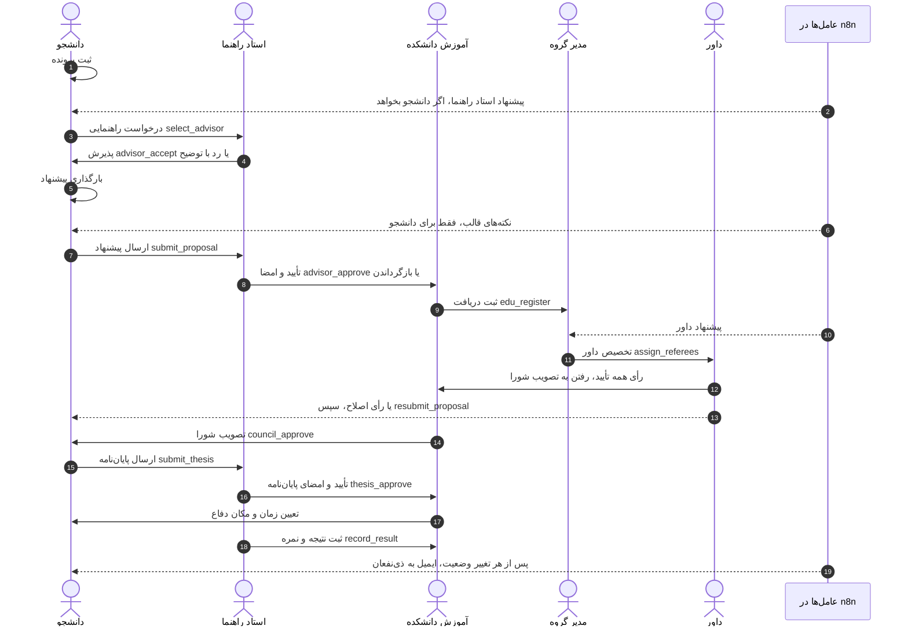

### ۶-۱. ورود و داشبورد نقش‌محور

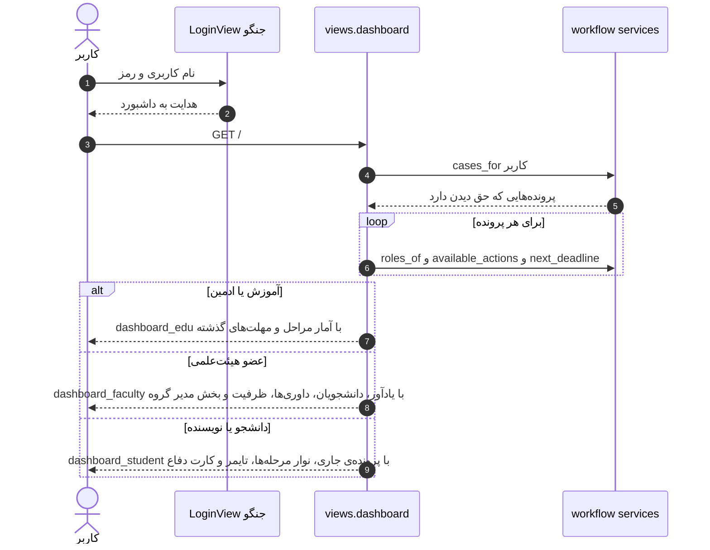

### ۶-۲. ثبت پرونده و انتخاب استاد راهنما (با پیشنهاد AI)

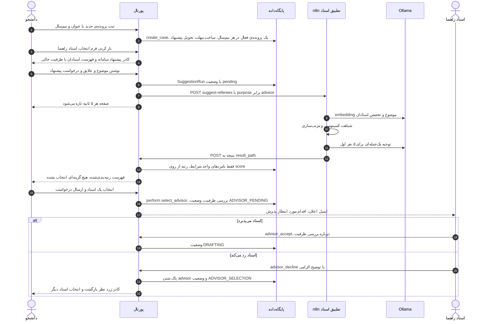

### ۶-۳. تدوین و بارگذاری پیشنهاد با نکته‌های AI

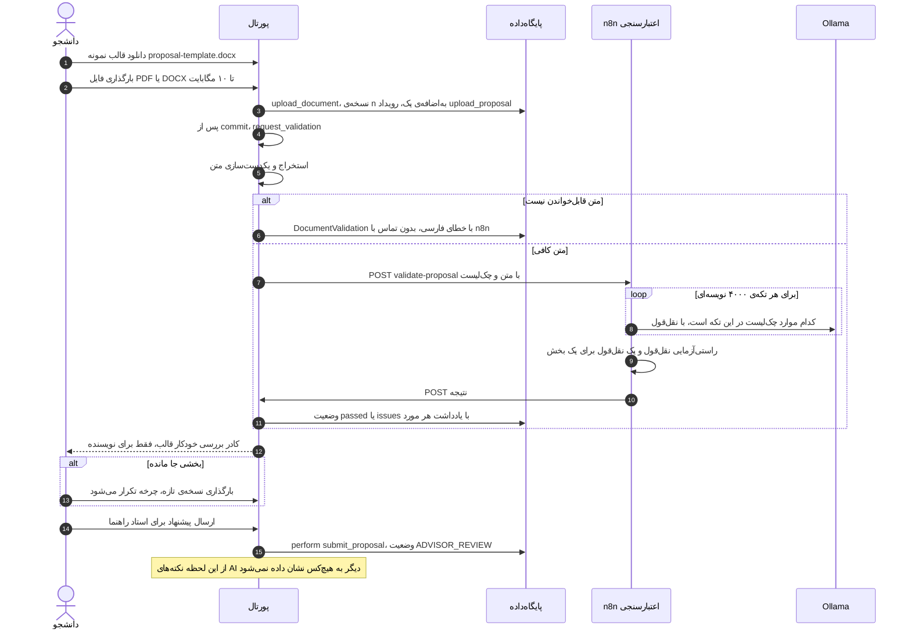

### ۶-۴. بررسی استاد راهنما در نمایشگر: نظر روی بخش‌ها، بازگرداندن، تأیید با امضای الکترونیک

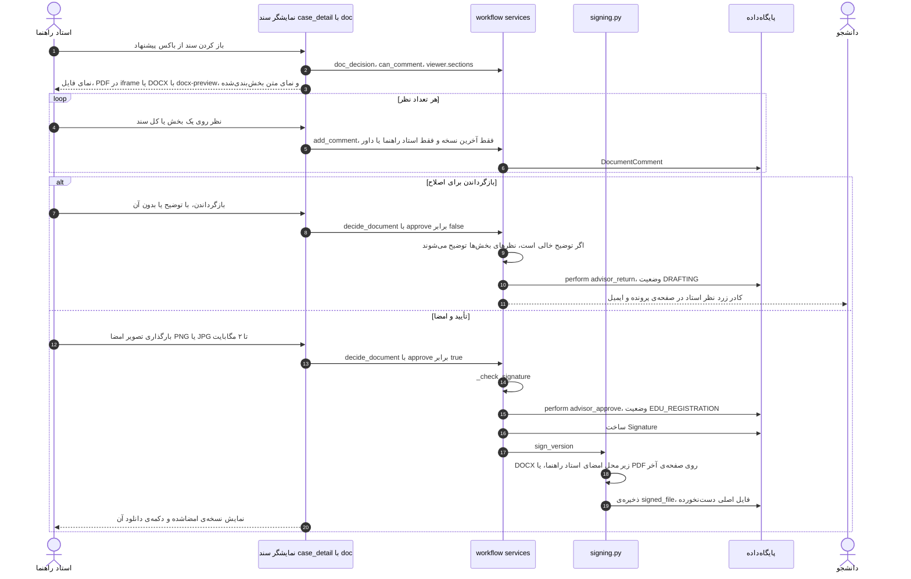

نکته: دکمه‌ی عمومی «تأیید» در `case_action` هم کاربر را به همین نمایشگر (`&panel=sign`) هدایت می‌کند؛ تأیید بدون امضا راهی ندارد.

### ۶-۵. ثبت در آموزش و تخصیص داور (با پیشنهاد AI)

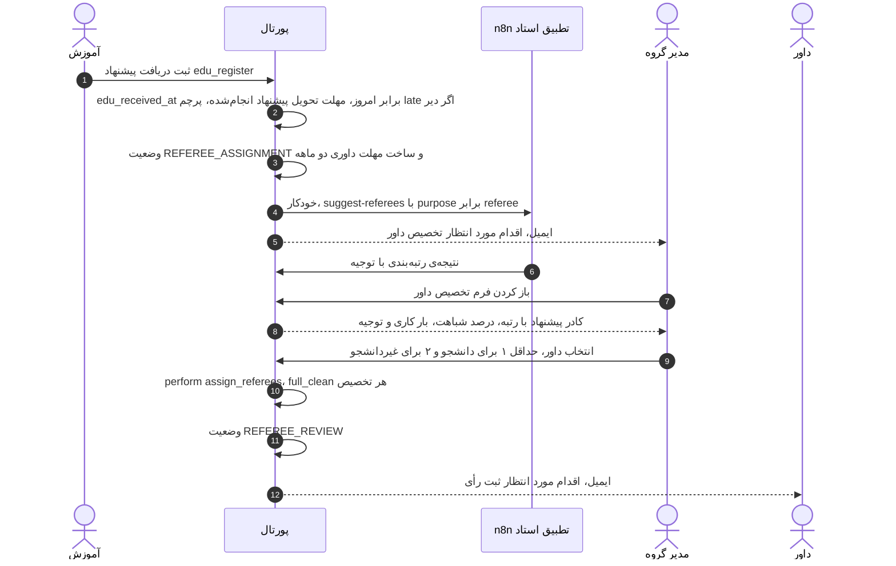

### ۶-۶. داوری و حلقه‌ی اصلاح

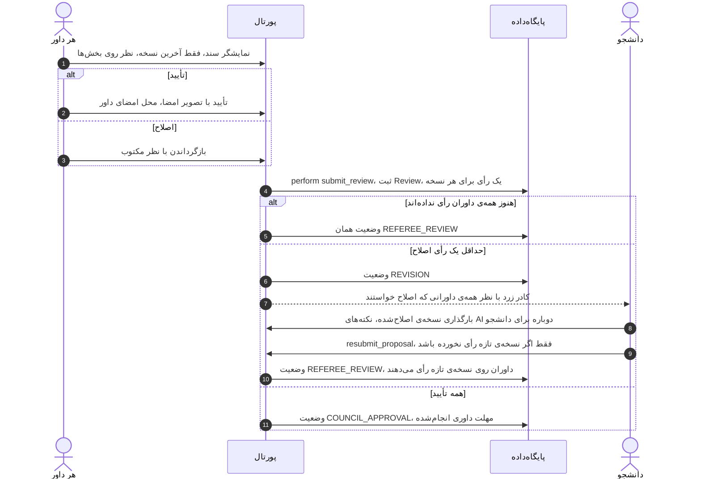

### ۶-۷. تصویب یا رد در شورای دانشکده

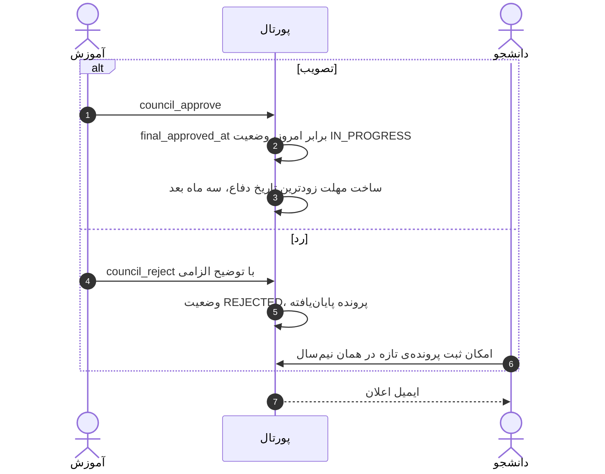

### ۶-۸. پایان‌نامه: بارگذاری، نکته‌های AI، تأیید با امضا

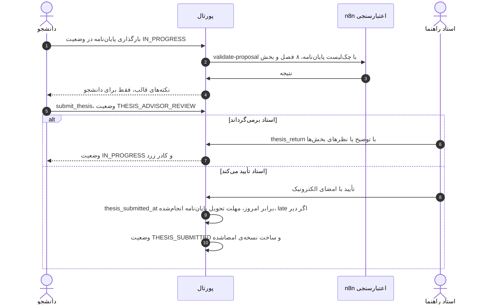

### ۶-۹. تعیین دفاع و ثبت نمره

```mermaid
sequenceDiagram
    autonumber
    actor Ed as آموزش
    actor Ad as استاد راهنما
    participant P as پورتال
    Ed->>P: schedule_defense با تاریخ شمسی و محل
    P->>P: بررسی تاریخ دفاع، دست‌کم سه ماه پس از تصویب
    P->>P: وضعیت DEFENSE_SCHEDULED
    Note over Ad,P: پیش از روز دفاع دکمه‌ی ثبت نتیجه غیرفعال است و waiting دارد
    Ad->>P: record_result در روز دفاع یا پس از آن
    alt نویسنده دانشجو
        P->>P: نمره‌ی ۰ تا ۲۰ الزامی، مهلت درج نمره انجام‌شده
    else نویسنده غیردانشجو
        P->>P: بدون نمره
    end
    P->>P: وضعیت COMPLETED
```

### ۶-۱۰. لغو پرونده

آموزش دانشکده در هر وضعیت فعال می‌تواند با توضیح الزامی `cancel` کند (وضعیت CANCELLED). پس از لغو هیچ اقدامی ممکن نیست و دانشجو می‌تواند در همان نیم‌سال پرونده‌ی تازه ثبت کند (قید یکتایی فقط پرونده‌های غیر ردشده/لغوشده را می‌شمارد).

### ۶-۱۱. اعلان تغییر وضعیت و یادآوری روزانه‌ی مهلت

```mermaid
sequenceDiagram
    autonumber
    participant P as پورتال
    participant DB as پایگاه‌داده
    participant N as n8n اطلاع‌رسانی
    participant M as Ollama
    participant MP as Mailpit
    Note over P,N: مسیر الف، تغییر وضعیت
    P->>P: build_event_notifications، گیرندگان با قاعده‌ی قطعی
    P->>DB: Notification با وضعیت queued
    P->>N: POST notify-event با facts و متن پشتیبان و پانویس
    Note over P,N: مسیر ب، هر روز ساعت ۸ یا دستور run_reminders
    N->>P: GET reminders/due
    P->>P: due_reminders، مرحله‌ی d14 تا overdue، حذف ارسال‌شده‌ها
    P-->>N: فهرست اعلان‌ها
    loop برای هر اعلان
        N->>M: جمله‌بندی پیام از روی واقعیت‌ها
        N->>N: متن مدل اگر ۲۰ تا ۱۲۰۰ نویسه، وگرنه متن پشتیبان
        N->>MP: ارسال ایمیل SMTP
        N->>P: POST notifications با key و status
        P->>DB: sent یا failed
    end
```

### ۶-۱۲. پرسش از دستیار آیین‌نامه (RAG)

```mermaid
sequenceDiagram
    autonumber
    actor U as کاربر
    participant JS as agents.js
    participant P as پورتال assistant_ask
    participant N as n8n rag-ask
    participant M as Ollama
    participant DB as pgvector
    U->>JS: پرسش در جعبه‌ی دستیار
    JS->>P: fetch POST با CSRF
    P->>P: بررسی طول پرسش و نمایه‌شده بودن پایگاه دانش
    P->>N: POST rag-ask، منتظر پاسخ تا ۳۰۰ ثانیه
    N->>M: embedding پرسش با bge-m3
    N->>P: POST rag/search با بردار و نام مدل
    P->>DB: CosineDistance، ۵ قطعه‌ی نزدیک‌تر با همان مدل
    P-->>N: قطعه‌ها با id و متن و score
    N->>M: پرامپت فقط بر اساس بندهای مرجع
    M-->>N: پاسخ با ارجاع شماره‌دار
    N-->>P: answer و sources با cited
    P->>DB: متن واقعی منابع از PolicyChunk و ثبت AssistantMessage
    P-->>JS: JSON
    JS-->>U: پاسخ با textContent و فهرست بندهای مرجع
```

### ۶-۱۳. دیدن و دانلود فایل (کنترل دسترسی)

```mermaid
sequenceDiagram
    autonumber
    actor U as کاربر
    participant V as document_inline یا document_download
    participant S as workflow services
    U->>V: GET documents pk
    V->>S: cases_for کاربر شامل پرونده‌ی این نسخه است؟
    alt نه
        V-->>U: 404
    else بله
        V->>S: can_download، نسخه‌ی پیشین فقط برای نویسنده، راهنما و آموزش
        alt اجازه ندارد
            V-->>U: 404
        else اجازه دارد
            V-->>U: FileResponse با nosniff، نسخه‌ی امضاشده با signed برابر 1
        end
    end
```

---

## ۷. مدل داده و پایگاه‌داده

### ۷-۱. نمودار ERD

```mermaid
erDiagram
    Department ||--o{ User : "members"
    Department ||--o{ ProjectCase : "department"
    User ||--o{ ProjectCase : "author"
    User |o--o{ ProjectCase : "advisor"
    User |o--o{ ProjectCase : "co_advisor"
    ProjectCase ||--o{ RefereeAssignment : "referee_assignments"
    User ||--o{ RefereeAssignment : "referee"
    ProjectCase ||--o{ DocumentVersion : "versions"
    DocumentVersion ||--o{ DocumentComment : "comments"
    DocumentVersion ||--o{ Signature : "signatures"
    RefereeAssignment ||--o{ Review : "reviews"
    DocumentVersion ||--o{ Review : "reviews"
    ProjectCase ||--o{ Deadline : "deadlines"
    ProjectCase ||--o{ CaseEvent : "events"
    DocumentVersion ||--o| DocumentValidation : "validation"
    ProjectCase ||--o{ SuggestionRun : "suggestion_runs"
    SuggestionRun ||--o{ RefereeSuggestion : "suggestions"
    ProjectCase ||--o{ Notification : "notifications"
    CaseEvent |o--o{ Notification : "event"
    Deadline |o--o{ Notification : "deadline"
    User |o--o{ AssistantMessage : "user"

    User {
        string username
        string user_type "student faculty edu_staff external"
        int department_id FK
        bool is_department_head
        string student_number
        text expertise "used by matching agent"
    }
    ProjectCase {
        string title_fa
        string title_en
        int academic_year "Jalali year"
        string semester
        date registration_date
        string state "16 states"
        date edu_received_at
        date final_approved_at
        date thesis_submitted_at
        date defense_date
        string defense_place
        decimal grade "0 to 20"
    }
    DocumentVersion {
        string kind "proposal thesis"
        int number
        file file
        string note
    }
    DocumentComment {
        int section "0 means whole document"
        string section_title
        text text
    }
    Signature {
        string role "advisor referee"
        file image
        file signed_file
    }
    Review {
        string decision "approve revise"
        text comment
    }
    Deadline {
        string kind "5 kinds"
        date due_date
        date satisfied_at
    }
    CaseEvent {
        string action
        string from_state
        string to_state
        text note
        json data "late, version_id, referee_ids"
    }
    PolicyChunk {
        string doc_code
        int position
        string ref
        text text
        vector embedding "pgvector"
        string embedding_model
    }
    DocumentValidation {
        string status "pending passed issues error"
        json items
    }
    SuggestionRun {
        string purpose "referee advisor"
        text query
        string status
    }
    RefereeSuggestion {
        int rank
        float score "cosine similarity"
        text reason
    }
    Notification {
        string kind "event reminder"
        string stage "d14 d7 d3 d1 d0 overdueN"
        string subject
        text body
        string generated_by "llm template"
        string status "queued sent failed"
    }
    AssistantMessage {
        text question
        text answer
        json sources
        bool ok
        int latency_ms
    }
```

جدول‌های `workflow` در بالا، جدول‌های `agents` (خروجی عامل‌ها) در پایین. هیچ جدول `agents` وضعیت پرونده را تغییر نمی‌دهد.

### ۷-۲. قیدها و دلیل هرکدام

قاعده‌هایی که «نباید هرگز شکسته شوند» در خود پایگاه‌داده هم قید شده‌اند، نه فقط در کد پایتون؛ پس حتی ادمین یا یک باگ هم نمی‌تواند داده‌ی ناسازگار بسازد.

| قید | جدول | معنا |
|---|---|---|
| `one_head_per_department` | User | هر گروه فقط یک مدیر |
| `advisor_required_after_selection` | ProjectCase | پس از مرحله‌ی انتخاب (به‌جز لغو) استاد راهنما و گروه الزامی است |
| `grade_between_0_and_20` | ProjectCase | نمره در بازه |
| `one_active_case_per_author_term` | ProjectCase | یک پرونده‌ی فعال برای هر نویسنده در هر نیم‌سال (ردشده و لغوشده حساب نمی‌شوند) |
| `unique_referee_per_case` | RefereeAssignment | هر داور یک‌بار در هر پرونده |
| `unique_version_number` | DocumentVersion | شماره‌ی نسخه یکتا برای هر نوع سند |
| `one_signature_per_signer` | Signature | هر استاد یک امضا روی هر نسخه |
| `one_review_per_referee_per_version` | Review | یک رأی برای هر داور روی هر نسخه |
| `one_deadline_per_kind` | Deadline | یک مهلت از هر نوع برای هر پرونده |
| فقط‌افزودنی | CaseEvent | `save` روی ردیف موجود و `delete` خطا می‌دهد (سابقه‌ی حسابرسی) |
| `unique_chunk_position` | PolicyChunk | ترتیب قطعه‌ها در هر سند |
| `one_run_per_purpose` | SuggestionRun | آخرین درخواست تطبیق برای هر پرونده و هدف |
| `one_row_per_referee` | RefereeSuggestion | هر استاد یک‌بار در هر فهرست |
| `one_event_notice_per_recipient`، `one_reminder_per_stage_per_recipient` | Notification | جلوگیری از ایمیل تکراری |

قواعدی که نیاز به داده‌ی چند جدول دارند در `clean()` مدل‌اند و `services._validated()` آن‌ها را اجرا می‌کند: داور باید هیئت‌علمی همان گروه و غیر از راهنما/نویسنده باشد (`RefereeAssignment.clean`)؛ رأی «اصلاح» نظر مکتوب لازم دارد و نسخه باید پیشنهاد همان پرونده باشد (`Review.clean`).

### ۷-۳. مهلت‌ها (Deadline)

| نوع | از روی چه چیزی محاسبه می‌شود | کی «انجام‌شده» می‌شود |
|---|---|---|
| `proposal_submission` | تاریخ ثبت‌نام + ۲ ماه | `edu_register` |
| `group_review` | `edu_received_at` + ۲ ماه | وقتی همه‌ی داوران تأیید کنند |
| `defense_earliest` | `final_approved_at` + ۳ ماه | هرگز؛ «کران پایین» است نه سررسید (`is_lower_bound`) و هیچ‌وقت «عقب‌افتاده» نمی‌شود |
| `thesis_delivery` | مهلت درج نمره − ۳ هفته (فقط دانشجو) | `thesis_approve` |
| `grade_entry` | ۳۰ مهر یا ۳۱ فروردین سال بعد (فقط دانشجو) | `record_result` |

انجام دیرهنگام مسدودکننده نیست؛ فقط `data.late=true` در `CaseEvent` ثبت می‌شود (داده‌ی ارزیابی سطح ۲).

---

## ۸. امنیت و کنترل دسترسی

1. **دسترسی به پرونده:** `services.cases_for(user)`. آموزش و ادمین همه را می‌بینند؛ بقیه فقط پرونده‌هایی که نویسنده، راهنما، داور یا (برای مدیر گروه) هم‌گروه آن‌اند. پرونده‌ی دیده‌نشدنی **۴۰۴** است، نه ۴۰۳، تا وجودش لو نرود (`views._case_or_404`).
2. **دسترسی به اقدام:** دو بار بررسی می‌شود: پیش از نمایش (`available_actions`) و در لحظه‌ی اجرا (`perform` با قفل). اعتماد به اینکه «دکمه نمایش داده نشده» کافی نیست.
3. **فایل‌ها:** `MEDIA_URL` عمومی سرو نمی‌شود؛ همه‌ی فایل‌ها (سند، امضا، نسخه‌ی امضاشده) فقط از ویوهایی با بررسی دسترسی (`_visible_version`، `_visible_signature`) و با `X-Content-Type-Options: nosniff` می‌آیند. نمایش درون iframe فقط با `xframe_options_sameorigin`.
4. **نسخه‌های پیشین:** فقط نویسنده، استاد راهنما و آموزش؛ داور و مدیر گروه فقط آخرین نسخه را می‌بینند (`sees_all_versions`).
5. **بارگذاری:** پسوند PDF/DOC/DOCX و ۱۰ مگابایت (`forms.UploadForm`)؛ امضا PNG/JPG و ۲ مگابایت (`_check_signature`).
6. **API عامل‌ها:** توکن مشترک با مقایسه‌ی زمان‌ثابت؛ بدون نشست؛ هیچ مسیری وضعیت را تغییر نمی‌دهد. حتی اگر توکن لو برود، مهاجم فقط می‌تواند خروجی عامل (پیشنهاد، چک‌لیست، اعلان) را دست‌کاری کند و نه تصمیم‌ها را.
7. **خروجی مدل در مرورگر:** در قالب‌های جنگو خودکار escape می‌شود و در JS دستیار با `textContent` درج می‌شود.
8. **CSRF:** همه‌ی فرم‌ها و `fetch` دستیار توکن CSRF دارند؛ فقط `/api/agents/` معاف است.

---

## ۹. آزمون، سناریوهای سرتاسری و حالت سایه

### ۹-۱. آزمون‌های خودکار (۱۶۷ آزمون)

| فایل | تعداد | چه چیزی |
|---|---|---|
| `workflow/tests.py` | ۱۷ | ماشین‌حالت و قواعد خالص (بدون DB هم معنا دارند) |
| `workflow/test_services.py` | ۳۱ | `perform`، نگهبان‌ها، اثرات، ظرفیت استاد |
| `workflow/test_portal.py` | ۲۹ | ویوها، دسترسی، داشبوردها |
| `workflow/test_documents.py` | ۱۸ | نمایشگر، نظر، امضا |
| `agents/tests.py` | ۶۰ | هر چهار عامل با n8n ساختگی (mock) |
| `integration/tests.py` | ۱۲ | هر هفت سناریو در هر اجرای `manage.py test` و پوشش همه‌ی ۱۶ وضعیت |

`python manage.py test` به n8n و مدل نیاز ندارد؛ فقط Postgres.

### ۹-۲. سناریوهای سرتاسری (`integration/`)
هفت سناریو (`happy_path`، `revision_loop`، `non_student`، `council_reject`، `late_and_reminders`، `guards`، `cancel`) به‌صورت داده تعریف شده‌اند: «در کدام روز، چه کسی، چه اقدامی، با چه ورودی، چه نتیجه‌ای». **ساعت شبیه‌سازی‌شده:** اجراکننده `timezone.localdate` را برای هر گام با روز آن گام جایگزین می‌کند، پس سناریوی ۱۳۰روزه در کسری از ثانیه اجرا می‌شود. دو حالت: **آفلاین** (عامل‌ها خاموش، همه‌چیز در یک تراکنش و rollback، فایل‌ها در پوشه‌ی موقت) و **زنده** (`--live`: پورتال واقعاً با n8n و مدل کار می‌کند و پس از هر گام منتظر پاسخ عامل می‌ماند). درستی گردش‌کار قطعی سنجیده می‌شود (✓/✗)؛ خروجی عامل‌ها «مشاهده» است (داده‌ی ارزیابی). `documents.py` فرم پیشنهاد مصنوعی با نقص عمدی می‌سازد تا «پاسخ درست» عامل اعتبارسنجی از پیش معلوم باشد.

نتیجه‌ی آخرین اجرای زنده (۱۱۰ گام): ۱۱۰ از ۱۱۰ درست؛ جزئیات در `docs/reports/e2e-live-20261011-1322.md`.

### ۹-۳. حالت سایه (Shadow mode)
با `AGENTS_SHADOW_MODE=True` عامل‌ها کار می‌کنند و همه‌چیز ثبت می‌شود، اما فقط آموزش و ادمین خروجی‌شان را می‌بینند و همه‌ی ایمیل‌ها به صندوق سایه می‌روند. چون تصمیم انسان «بی‌خبر از پیشنهاد عامل» گرفته شده، `shadow_report` می‌سنجد اگر پیشنهاد نشان داده شده بود چقدر با تصمیم انسان هم‌خوان بود: **hit@1، hit@3 و MRR** برای تطبیق استاد، جدول دوبه‌دو «نتیجه‌ی بررسی قالب × تصمیم استاد راهنما»، آمار اعلان‌ها و دستیار. تنها نقطه‌ی تصمیم: `agents.services.visible_to(user)`.

---

## ۱۰. نقشه‌ی فایل‌ها

| اگر می‌خواهید… | این فایل را باز کنید |
|---|---|
| یک وضعیت یا گذار تازه بیفزایید | `workflow/enums.py`، `workflow/statemachine.py`، اثر آن در `workflow/services.py` ← `_EFFECTS`، یک migration |
| یک عدد آیین‌نامه را عوض کنید | `workflow/rules.py` |
| بفهمید یک دکمه چرا غیرفعال است | `workflow/services.py` ← `blocker()` |
| بفهمید چه کسی چه پرونده‌ای را می‌بیند | `workflow/services.py` ← `cases_for()`، `visible_versions()` |
| داشبورد یک نقش را تغییر دهید | `workflow/views.py` ← `_student_context` / `_faculty_context` / `_edu_context` و قالب `dashboard_*.html` |
| نمایشگر سند و نظر و امضا | `workflow/views.py` ← `_panel`، `document_decide`؛ `workflow/services.py` ← `decide_document`؛ `workflow/signing.py`؛ `workflow/templates/workflow/_doc_panel.html` |
| چک‌لیست قالب را عوض کنید | `agents/checklist.py` (n8n به هیچ مورد خاصی وابسته نیست) |
| پرامپت یک عامل را عوض کنید | گره‌ی Code همان گردش‌کار در `n8n/workflows/*.json` (در n8n ویرایش، Export، جایگزینی فایل) |
| بفهمید یک عامل کی صدا زده می‌شود | `agents/services.py` ← `handle_event()` و ویوهای `agents/views.py` |
| نتیجه‌ی n8n چطور ذخیره می‌شود | `agents/api.py` و `save_*`/`record_*` در `agents/services.py` |
| استخراج متن فارسی را اصلاح کنید | `agents/extract.py` |
| قطعه‌بندی پایگاه دانش یا بخش‌بندی نمایشگر | `agents/chunking.py` |
| یک سناریوی سرتاسری بیفزایید | `integration/scenarios.py` |
| داده‌ی نمونه | `workflow/management/commands/seed_demo.py` |
| تنظیمات و متغیرها | `core/settings.py`، `.env.example`، `docker-compose.yml` |

---

## ۱۱. دستورهای کلیدی

```bash
# راه‌اندازی
docker compose up -d                       # db + n8n + mailpit
python manage.py migrate
python manage.py seed_demo [--full]        # داده‌ی نمونه
bash n8n/import.sh                         # وارد و فعال کردن گردش‌کارها
python manage.py runserver 0.0.0.0:8000

# عامل‌ها
python manage.py agents_check [--ask "پرسش"]     # آزمون گام‌به‌گام اتصال
python manage.py index_policy [path --code X --title Y] [--dry-run] [--list]
python manage.py run_reminders [--today YYYY-MM-DD | --days-ahead N] [--dry-run]

# آزمون و ارزیابی
python manage.py test [workflow|agents|integration]
python manage.py run_scenarios [--list] [--live] [--keep] [--report docs/reports] [نام سناریو]
python manage.py shadow_report [--include-scenarios] [--output مسیر]

# کمکی
python manage.py backdate_case <شماره>     # فقط با DEBUG
python manage.py export_statemachine       # جدول و نمودار ماشین‌حالت از روی کد
```

---

## ۱۲. پرسش و پاسخ برای خودآزمایی

اول پاسخ را خودتان بگویید، بعد باز کنید. این‌ها همان پرسش‌هایی است که در جلسه‌ی دفاع یا مصاحبه‌ی فنی محتمل است.

<details><summary>۱. اگر n8n خاموش باشد، دانشجو می‌تواند پیشنهادش را بفرستد؟</summary>

بله. `n8n.post` خطای `Unavailable` می‌دهد، `request_validation` آن را به `DocumentValidation` با وضعیت `error` تبدیل می‌کند و کادر «بررسی انجام نشد» نشان داده می‌شود. اقدام `submit_proposal` هیچ وابستگی‌ای به نتیجه‌ی بررسی ندارد (`blocker` فقط وجود نسخه را می‌سنجد). عامل‌ها هم پس از commit و درون `try` جدا اجرا می‌شوند (`handle_event`).
</details>

<details><summary>۲. کجای کد تضمین می‌کند AI هیچ تصمیمی نمی‌گیرد؟</summary>

تنها مسیر تغییر وضعیت `workflow/services.py` ← `perform()` است و نیاز دارد `actor` یک کاربر با نقش زمینه‌ای لازم باشد. هیچ فایلی در `agents/` آن را صدا نمی‌زند، API داخلی `agents/api.py` فقط جدول‌های خروجی عامل را می‌نویسد، و در ماشین‌حالت هیچ actorی «عامل» نیست. فرم‌ها هم پیشنهاد را فقط برای مرتب‌سازی به کار می‌برند و چیزی را از پیش انتخاب نمی‌کنند.
</details>

<details><summary>۳. چرا رتبه‌بندی داور با embedding است و نه با پرسیدن از LLM؟</summary>

شباهت کسینوسی قطعی، سریع، تکرارپذیر و قابل‌توضیح (یک عدد) است و با مدل کوچک هم درست کار کرد (هر دو اجرای `gemma3:1b` و `4b` رتبه‌ی ۱ درست). LLM فقط توجیه متنی می‌نویسد و اگر شکست بخورد رتبه‌بندی سالم می‌ماند. رتبه را هم خود پورتال از روی score می‌سازد.
</details>

<details><summary>۴. اگر مدل زبانی بگوید «مقدمه» وجود دارد ولی ندارد چه می‌شود؟</summary>

مدل باید نقل‌قول عینی بیاورد. گره‌ی `Aggregate And Verify` بررسی می‌کند نقل‌قول (پس از یکدست‌سازی) واقعاً در همان تکه هست یا ۷۰٪ واژه‌هایش هست. اگر نبود، مورد در `unverified` می‌رود و پورتال آن را ✗ با یادداشت «شاهد تأیید نشد؛ خودتان بررسی کنید» نشان می‌دهد.
</details>

<details><summary>۵. چرا متن منابع دستیار از پایگاه‌داده خوانده می‌شود نه از پاسخ n8n؟</summary>

تا مدل نتواند متن بند را جعل یا تحریف کند. n8n فقط `chunk_id` و `score` و `cited` را برمی‌گرداند و `_sources()` متن را از `PolicyChunk` می‌خواند.
</details>

<details><summary>۶. پورتال چطور می‌فهمد n8n واقعاً n8n است؟ و برعکس؟</summary>

با راز مشترک `AGENT_TOKEN` در سرآیند `X-Agent-Token`. پورتال در `agents/api.py` ← `agent_api` با `constant_time_compare` بررسی می‌کند؛ n8n در نخستین گره‌ی Code هر گردش‌کار با `$env.AGENT_TOKEN`.
</details>

<details><summary>۷. چرا Webhookهای اعتبارسنجی و تطبیق «ناهم‌زمان» و دستیار «هم‌زمان» است؟</summary>

اعتبارسنجی چند فراخوانی LLM دارد و ممکن است دقیقه‌ها طول بکشد؛ نباید درخواست وب را نگه داشت. پس `onReceived` + callback + تازه‌سازی خودکار صفحه. در دستیار کاربر منتظر همان پاسخ است، پس `lastNode` با timeout ۳۰۰ ثانیه.
</details>

<details><summary>۸. نقش کاربر کجا ذخیره می‌شود؟</summary>

ذخیره نمی‌شود. `user_type` نوع حساب است؛ نقش (author، advisor، head، referee، edu) هر بار با `ProjectCase.roles_of(user)` از روی رابطه‌ها محاسبه می‌شود، چون یک استاد می‌تواند هم‌زمان راهنمای یک پرونده و داور پرونده‌ی دیگر باشد.
</details>

<details><summary>۹. اگر دو داور هم‌زمان رأی بدهند وضعیت درست حساب می‌شود؟</summary>

بله. `perform` پرونده را با `select_for_update` قفل می‌کند؛ رأی دوم پس از commit اولی اجرا می‌شود و در `_submit_review` می‌بیند همه رأی داده‌اند.
</details>

<details><summary>۱۰. چرا ایمیل‌ها تکراری فرستاده نمی‌شوند حتی اگر n8n دو بار اجرا شود؟</summary>

کلید هر اعلان (`event:<رویداد>:<گیرنده>` یا `reminder:<مهلت>:<مرحله>:<گیرنده>`) را پورتال می‌سازد؛ قیدهای یکتایی جدول `Notification` و `update_or_create` در `record_notification` تکرار را جذب می‌کنند، و `due_reminders` مواردی را که `SENT` شده‌اند دوباره نمی‌آورد.
</details>

<details><summary>۱۱. «امضای الکترونیک» در این سامانه یعنی چه؟ امضای دیجیتال رمزنگاری‌شده است؟</summary>

خیر. تصویر امضای استاد روی نسخه‌ای جدا از سند گذاشته می‌شود (`signing.py`) و یک ردیف `Signature` (چه کسی، با چه نقشی، چه زمانی، روی کدام نسخه) به‌اضافه‌ی `CaseEvent` همان تأیید ثبت می‌شود. اصالت به کنترل دسترسی پورتال و دفتر رویداد فقط‌افزودنی تکیه دارد، نه به گواهی دیجیتال (PKI). فایل اصلی هرگز تغییر نمی‌کند.
</details>

<details><summary>۱۲. چرا نکته‌های بررسی قالب به استاد راهنما نشان داده نمی‌شود؟</summary>

تصمیم محصول (PR #6): این نکته‌ها کمک «پیش از ارسال» برای دانشجوست. نشان دادنش به استاد یا داور ممکن است داوری انسانی را سوگیرانه کند و خطاهای مدل را به تصمیم رسمی برساند. کد: `agents/services.py` ← `validation_visible_to`.
</details>

<details><summary>۱۳. اگر مدل embedding را عوض کنیم چه می‌شود؟</summary>

جست‌وجو فقط میان قطعه‌هایی است که با همان مدل نمایه شده‌اند (`embedding_model`)، پس دستیار خطای «با مدل X نمایه نشده» می‌دهد تا `index_policy` دوباره اجرا شود. ستون برداری بُعد ثابت ندارد، پس migration لازم نیست. تطبیق استاد هر بار هر دو طرف را تازه embed می‌کند و مشکلی ندارد.
</details>

<details><summary>۱۴. حالت سایه برای چیست و چطور ارزیابی می‌کند؟</summary>

عامل‌ها کار می‌کنند ولی فقط آموزش و ادمین خروجی را می‌بینند و ایمیل‌ها به صندوق سایه می‌روند؛ پس تصمیم انسان مستقل از پیشنهاد است. `shadow_report` رتبه‌ی گزینه‌ی انسان در فهرست عامل را می‌سنجد (hit@1، hit@3، MRR) و نتیجه‌ی بررسی قالب را با تصمیم استاد مقایسه می‌کند.
</details>

<details><summary>۱۵. سناریوی ۱۳۰روزه چطور در یک ثانیه اجرا می‌شود؟</summary>

همه‌ی قواعد «امروز» را از `django.utils.timezone.localdate` می‌گیرند. `integration/runner.py` برای هر گام این تابع را با `mock.patch` به روز همان گام عوض می‌کند.
</details>

<details><summary>۱۶. چرا جدول مهلت‌ها ذخیره می‌شود وقتی از روی تاریخ‌ها قابل‌محاسبه است؟</summary>

برای کوئری کارآمد (داشبورد آموزش «مهلت‌های گذشته»، `due_reminders`)، برای ثبت «زمان انجام» (`satisfied_at`) و برای اینکه اعلان‌ها به یک ردیف مهلت ارجاع دهند. `sync_deadlines()` پس از هر گذار آن را با محاسبه هماهنگ نگه می‌دارد.
</details>

<details><summary>۱۷. وقتی داور رأی «اصلاح» می‌دهد، دانشجو نظر را کجا می‌بیند؟</summary>

`services.pending_feedback` اگر آخرین تغییر وضعیت `submit_review` به REVISION باشد، همه‌ی رأی‌های «اصلاح» آخرین نسخه را در کادر زرد بالای صفحه‌ی پرونده نشان می‌دهد؛ نظرهای بخش‌به‌بخش هم در نمایشگر سند است. ایمیل فقط می‌گوید چه اتفاقی افتاد، نه متن نظر.
</details>

<details><summary>۱۸. نمایشگر سند چطور بخش‌ها را تشخیص می‌دهد؟ AI است؟</summary>

خیر. `workflow/viewer.py` متن را با `agents/extract.py` می‌خواند و هر سطری را که `agents/chunking.heading_ref` عنوان بشناسد (شماره‌ی بند، «فصل ۲»، سرخط Markdown) شروع یک بخش می‌گیرد. همان قاعده‌ی قطعه‌بندی RAG است.
</details>

<details><summary>۱۹. چرا pgvector و نه یک پایگاه برداری جدا؟</summary>

حجم پایگاه دانش کوچک است (چند ده تا چند صد قطعه)، یک سرویس کمتر برای نصب و پشتیبان‌گیری، تراکنش مشترک با بقیه‌ی داده‌ها، و جست‌وجو با همان ORM جنگو (`CosineDistance`).
</details>

<details><summary>۲۰. چرا فرم‌ها هیچ قاعده‌ای را بررسی نمی‌کنند؟</summary>

تا قواعد فقط یک‌جا (`services.py`) باشند و برای فرم وب، پنل ادمین، سناریوهای سرتاسری و هر ورودی آینده یکسان اجرا شوند. فرم فقط ورودی را به نوع درست تبدیل می‌کند.
</details>

---

## ۱۳. واژه‌نامه

| اصطلاح | معنا در این پروژه |
|---|---|
| **Agent (عامل)** | یک گردش‌کار n8n که با مدل زبانی یا embedding کاری انجام می‌دهد و خروجی‌اش فقط پیشنهاد است |
| **Human-in-the-loop** | هر تصمیم را انسان می‌گیرد؛ AI فقط کمک می‌کند |
| **State machine (ماشین‌حالت)** | مجموعه‌ی وضعیت‌های پرونده و گذارهای مجاز میانشان (`statemachine.py`) |
| **Transition (گذار)** | یک اقدام که پرونده را از وضعیتی به وضعیت دیگر می‌برد |
| **Guard (نگهبان/پیش‌شرط)** | شرطی که باید برقرار باشد تا گذار انجام شود؛ خطای آن `GuardFailed` |
| **Effect (اثر جانبی)** | تغییرهای همراه گذار (تاریخ‌ها، تخصیص‌ها، مهلت‌ها) در `_EFFECTS` |
| **Contextual role (نقش زمینه‌ای)** | نقش کاربر نسبت به یک پرونده‌ی مشخص (`roles_of`) |
| **CaseEvent / Audit log** | دفتر رویداد فقط‌افزودنی؛ هم سابقه و هم محرک عامل‌ها |
| **Signal / on_commit** | سازوکار جنگو برای گوش دادن به ذخیره‌ی یک مدل؛ اجرای کد پس از قطعی شدن تراکنش |
| **Webhook** | نشانی HTTP در n8n که با فراخوانی‌اش گردش‌کار شروع می‌شود |
| **Callback / result path** | نشانی‌ای در پورتال که n8n نتیجه‌ی کار ناهم‌زمان را به آن POST می‌کند |
| **LLM** | مدل زبانی بزرگ؛ این‌جا `gemma3:4b` روی Ollama |
| **Embedding** | تبدیل متن به بردار عددی که شباهت معنایی را نشان می‌دهد؛ این‌جا `bge-m3` |
| **Cosine similarity** | معیار شباهت دو بردار (۱ = هم‌جهت)؛ برای رتبه‌بندی استاد و بازیابی RAG |
| **RAG** | Retrieval-Augmented Generation: اول بندهای مرتبط بازیابی، بعد پاسخ فقط از روی آن‌ها |
| **Chunk (قطعه)** | تکه‌ای از سند رویه با برچسب بند (`ref`) که جداگانه نمایه می‌شود |
| **pgvector** | افزونه‌ی Postgres برای ذخیره و جست‌وجوی بردار |
| **Window (تکه)** | بخش ۴۰۰۰ نویسه‌ای متن سند برای عامل اعتبارسنجی (map-reduce) |
| **Evidence (شاهد)** | نقل‌قول عینی که مدل باید برای هر ادعا بیاورد |
| **Hallucination (توهم)** | تولید ادعای نادرست توسط مدل؛ با شاهد، محدودسازی ورودی و راستی‌آزمایی مهار شده |
| **Fallback** | متن یا رفتار جایگزین وقتی مدل شکست می‌خورد |
| **Shadow mode (حالت سایه)** | اجرای عامل‌ها بدون نمایش به کاربران عادی، برای ارزیابی |
| **hit@k / MRR** | معیارهای رتبه‌بندی: آیا گزینه‌ی درست در k رتبه‌ی اول است / میانگین معکوس رتبه |
| **Stale (بی‌پاسخ)** | درخواست عاملی که پس از ۱۰ دقیقه جوابش نرسیده |
| **Idempotency** | اجرای دوباره‌ی یک عمل نتیجه را عوض نکند (کلید اعلان، شناسه‌ی ثابت گردش‌کار) |
| **Signed copy (نسخه‌ی امضاشده)** | فایل جداگانه با تصویر امضا؛ فایل اصلی دست‌نخورده |

---

## ۱۴. محدودیت‌ها و نکته‌های ریز کد

این‌ها را بدانید تا در پاسخ به پرسش‌ها غافلگیر نشوید (هیچ‌کدام در این سند اصلاح نشده‌اند):

1. **فراخوانی عامل‌ها در همان درخواست وب است.** `on_commit` در همان thread اجرا می‌شود، پس `handle_event` و `n8n.post` (timeout ده ثانیه) پس از commit و پیش از پاسخ به کاربر اجرا می‌شوند. چون Webhookها `onReceived` هستند معمولاً سریع است، ولی اگر n8n «آویزان» باشد کاربر تا ده ثانیه منتظر می‌ماند. راه بهتر برای مقیاس بزرگ: یک صف کار (مثل Celery یا RQ).
2. **نام Webhook `validate-proposal` برای پایان‌نامه هم به کار می‌رود**؛ فرق فقط در چک‌لیست ارسالی است.
3. **docstring `case_action` در `workflow/views.py` از «۱۷ گذار» می‌گوید؛ تعداد فعلی ۱۸ است** (پس از افزوده شدن `advisor_accept`/`advisor_decline` و حذف مرحله‌ی گروه).
4. **`docs/phase4.md` بند ۶** هنوز می‌گوید استاد و داور نکته‌های قالب را می‌بینند؛ کد فعلی (PR #6) فقط نویسنده و فقط هنگام بارگذاری.
5. **امضا رمزنگاری‌شده نیست** (پرسش ۱۱).
6. **توکن مشترک و `N8N_BLOCK_ENV_ACCESS_IN_NODE=false`** برای محیط توسعه‌اند؛ استقرار واقعی HTTPS و مدیریت راز می‌خواهد.
7. **کیفیت تطبیق استاد به متن آزاد «زمینه‌های تخصصی» وابسته است**؛ استاد بدون تخصص ثبت‌شده رتبه نمی‌گیرد.
8. **استخراج متن PDF راست‌به‌چپ بی‌نقص نیست** (`_repair_rtl` دو خطای شناخته‌شده را تعمیر می‌کند)؛ DOCX مطمئن‌تر است. PDF اسکن‌شده اصلاً بررسی نمی‌شود.
9. **دستیار حافظه‌ی گفتگو ندارد** و پایگاه دانش فعلی فقط متن فرم پیشنهاد است تا سند AUT-PR-3210 نمایه شود.
10. **متن سند بیش از ۶۰٬۰۰۰ نویسه بریده می‌شود** (`MAX_DOC_CHARS`) و `truncated` در payload می‌آید.
11. **`eligible_advisors` ظرفیت را برای هر استاد با یک کوئری جدا می‌شمارد**؛ برای چند ده استاد مشکلی نیست.
12. **پیامک پیاده نشده** (پروپوزال «در صورت نیاز» گفته بود).

---

*این سند از روی کد شاخه‌ی `main` (پس از PR #6) و اسناد `docs/phase3.md`، `docs/phase4.md`، `docs/INSTALL.md`، `docs/reports/`، `phases.md` و `proposal.md` نوشته شده است. اگر کد عوض شد، جدول گذارها و نمودار وضعیت را با `python manage.py export_statemachine` از روی خود کد بازسازی کنید.*
